# Shima System Architecture & Behavioral Diagrams

**Document Role**: Master architectural breakdown across Shima's 5 decoupled layers (Presentation, Application Core, Windows Integration, Widget Modules, Infrastructure) and all 17 system, sequence, and data-flow diagrams.  
**Related**: [plan.md](file:///C:/Users/chris/Projects/shima/specs/001-shima-dynamic-island/plan.md) | [widget-contract.md](file:///C:/Users/chris/Projects/shima/specs/001-shima-dynamic-island/contracts/widget-contract.md)

---

## 1. Layered Responsibilities (Refined from Specification Section 2)

| Layer | Assembly | Responsibilities |
| :--- | :--- | :--- |
| **A. Presentation** | `Shima.Presentation` | Island Overlay Window, concave top-fillet vector renderer, 8-dot vertical carousel, `WidgetHost`, Settings Window (`10` sidebar sections), Hardware/Composition Animation Engine (reduced-motion aware), Theme Renderer, Advanced Color Picker Dialog, Live Appearance Preview binding. |
| **B. Application Core** | `Shima.Core` | `ApplicationLifecycleManager`, `WidgetRegistry`, `WidgetLifecycleManager`, `EventDispatcher` (typed pub/sub), `IslandStateManager`, `ConfigurationManager`, `BackgroundTaskCoordinator`, `AppearanceManager`, `AppearanceEditingSession`, `OverlayPinController`. |
| **C. Windows Integration** | `Shima.WindowsInterop` | `OverlayWindowAdapter`, `NotificationListenerAdapter` (`UserNotificationListener`), `MediaSessionAdapter` (`GSMTC`), `AudioMixerAdapter` (`CoreAudio`/`WASAPI`), `ClipboardMonitorAdapter` (`WM_CLIPBOARDUPDATE`), `StartupRegistrationAdapter`, `DisplayTopologyMonitor`, `FocusActivationHandler`, `FullscreenDetector`, `PowerAndMotionMonitor`, `ZenDisplayEffectAdapter` (`MagSetFullscreenColorEffect`). |
| **D. Widget Modules** | `Shima.Widgets.*` | 8 isolated `IWidgetModule` plugins: `Clock`, `NowPlaying`, `FocusTimer`, `Notes`, `Inbox`, `Clipboard`, `VolumeMixer`, and `Developer` (Phase 2: `ClaudeCodeAdapter` + `OpenCodeAdapter`). |
| **E. Infrastructure** | `Shima.Infrastructure` | `SqliteDatabase` (WAL mode + repositories), `AtomicConfigStore` (JSON + corrupt recovery), `DpapiSecretStore`, `SanitizedFileLogger`, `ColorProcessingService` (HSB/RGB/HEX + WCAG contrast), `PresetManager`, `UpdateServiceAdapter`, `LicenseServiceAdapter`. |

---

## 2. System Context & High-Level Component Architecture

### Diagram 1: System Context Diagram

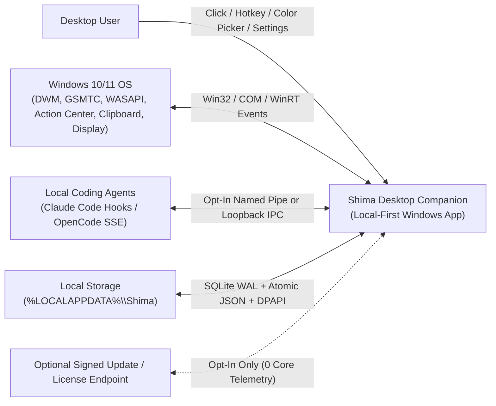

### Diagram 2: High-Level Component Architecture

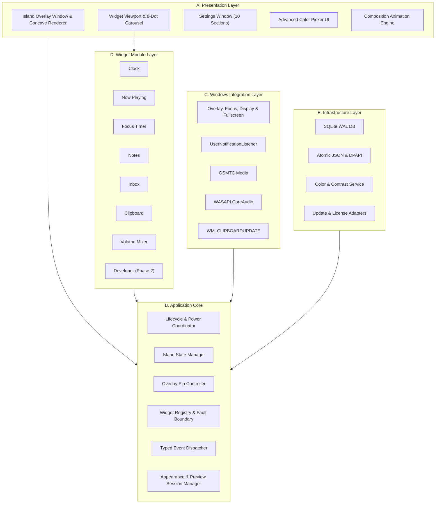

---

## 3. Core Lifecycle & Shell State Diagrams

### Diagram 3: Application Startup Sequence

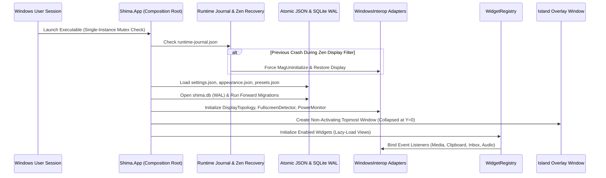

### Diagram 4: Widget Lifecycle State Machine

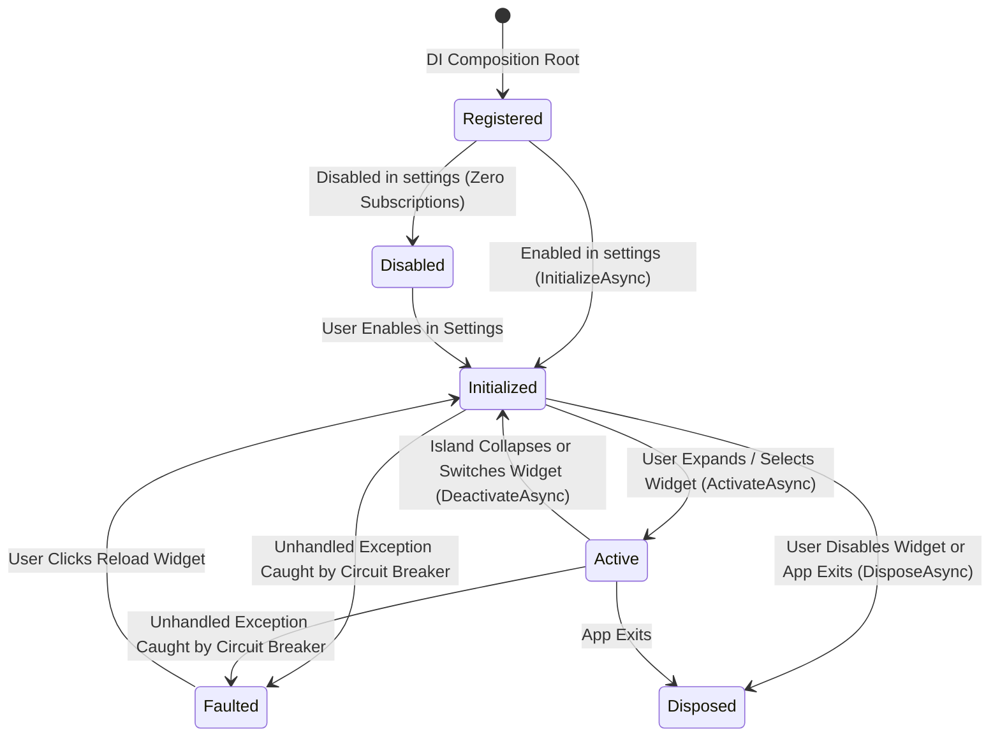

### Diagram 5: Island Expansion & Collapse State Flow

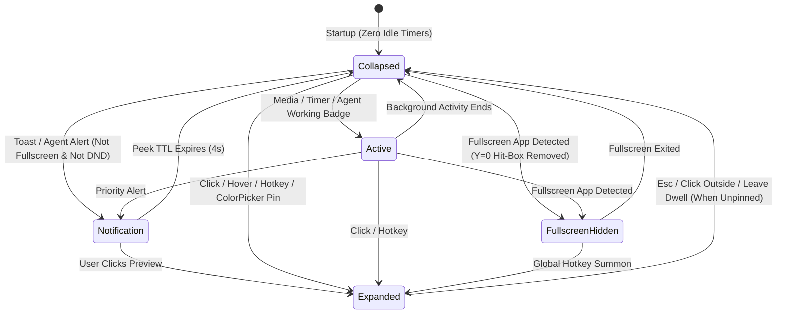

---

## 4. Windows Integration & Widget Event Flows

### Diagram 6: Notification Handling Flow (`Inbox`)

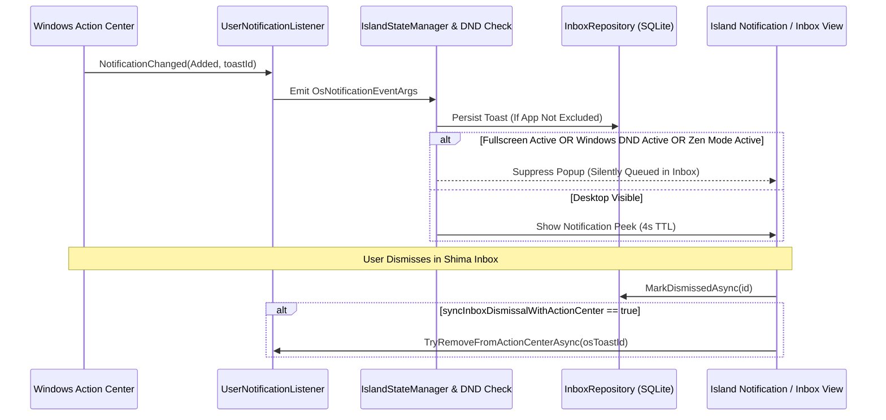

### Diagram 7: Media Session Handling (`Now Playing`)

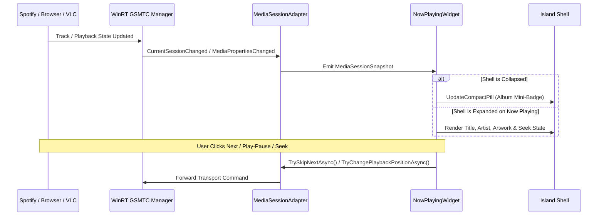

### Diagram 8: Clipboard Collection & Retrieval (`Clipboard`)

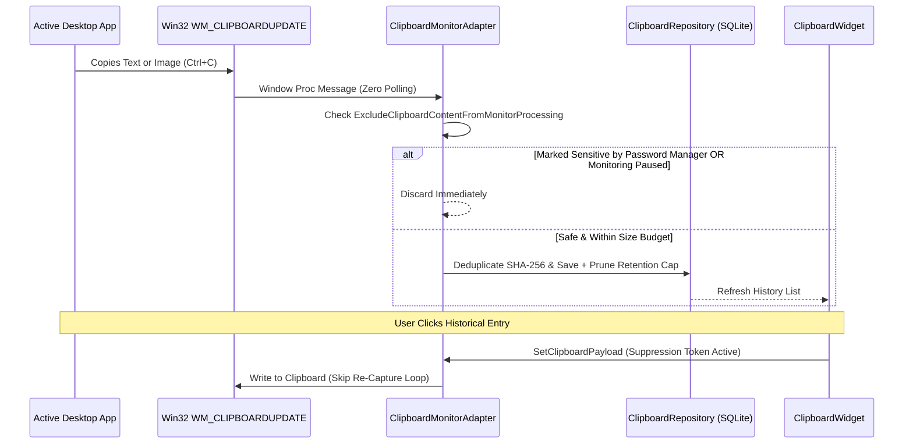

### Diagram 9: Audio Session Management (`Volume Mixer`)

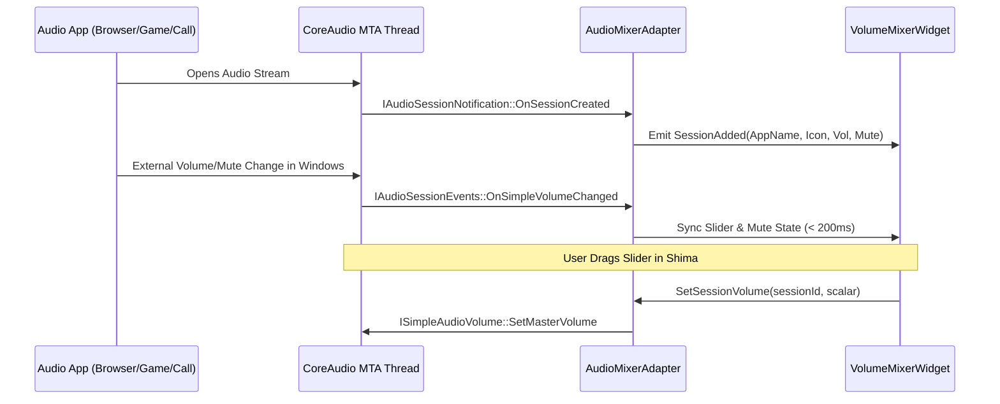

### Diagram 10: Developer Integration Event Flow (`Claude Code` & `OpenCode`)

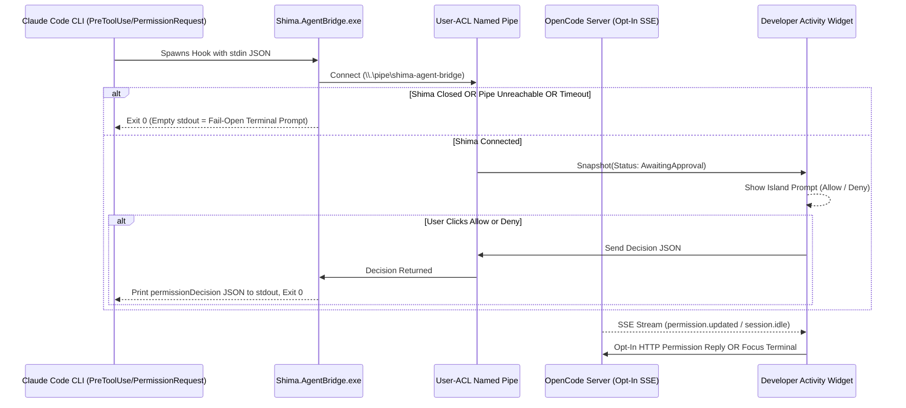

---

## 5. Persistence, Licensing & Color Appearance Flows

### Diagram 11: Local Persistence & Data Flow

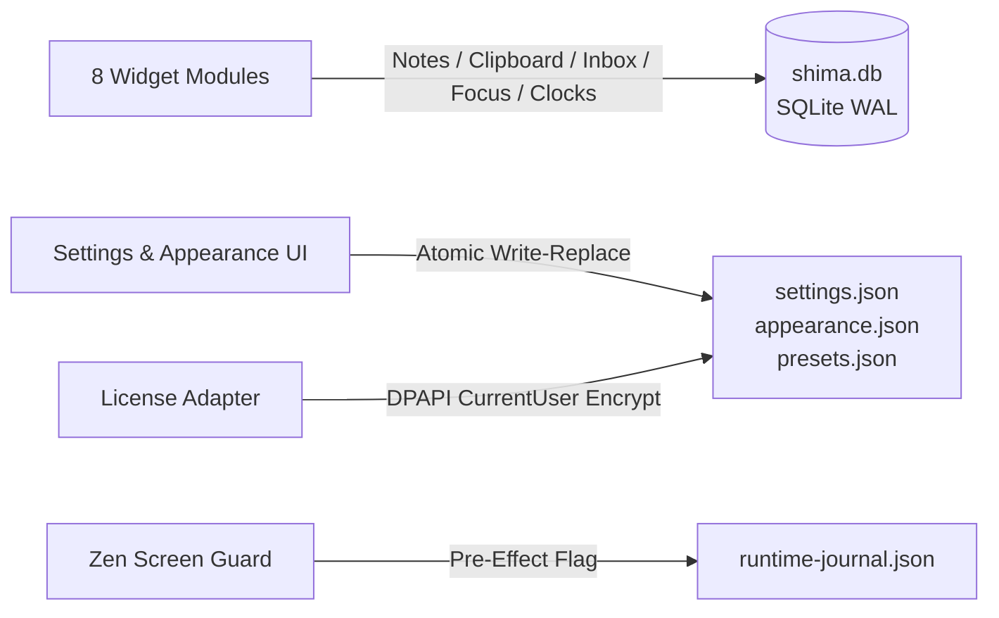

### Diagram 12: License Validation Flow *(Optional Modular Adapter)*

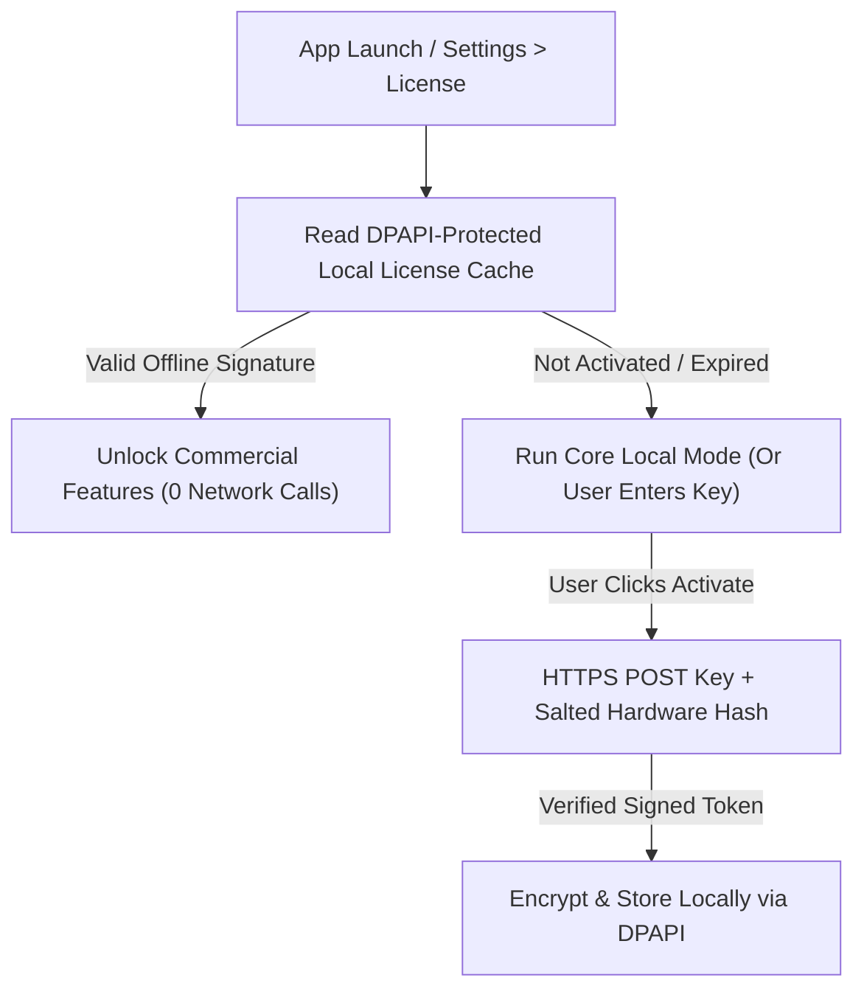

### Diagram 13: Color Picker Interaction Flow (`FR-PICKER-006`)

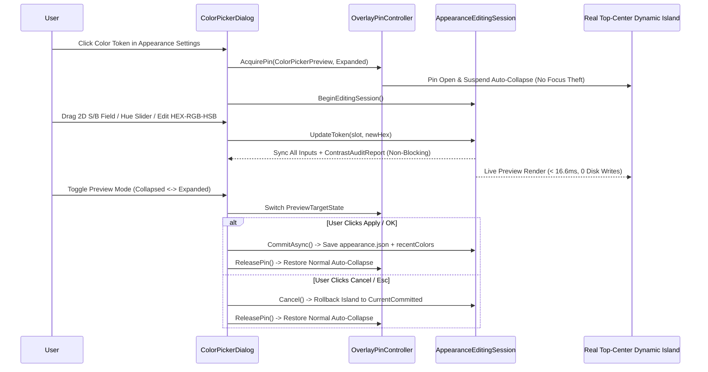

### Diagram 14: Color Conversion & Synchronization Pipeline

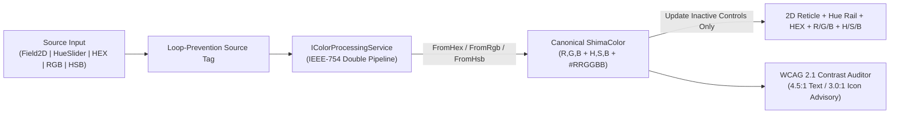

### Diagram 15: Live Appearance Preview & Render Coalescing

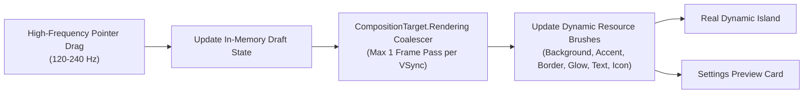

### Diagram 16: Island Pinning & Unpinning Lifecycle

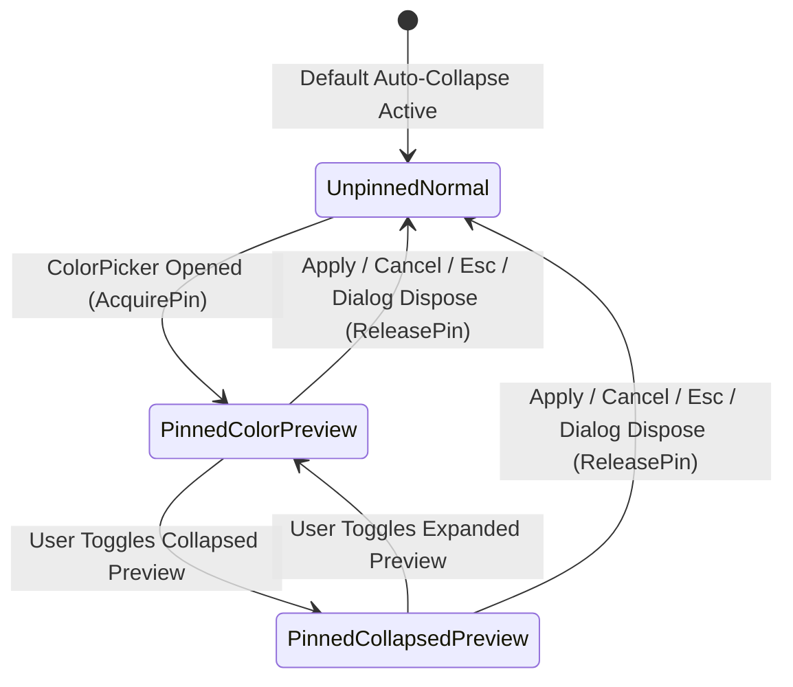

### Diagram 17: Appearance Configuration Persistence

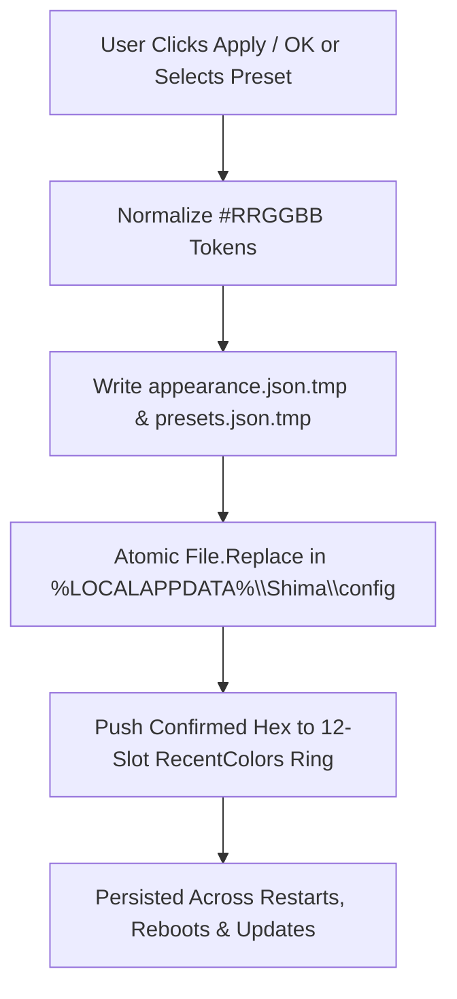
