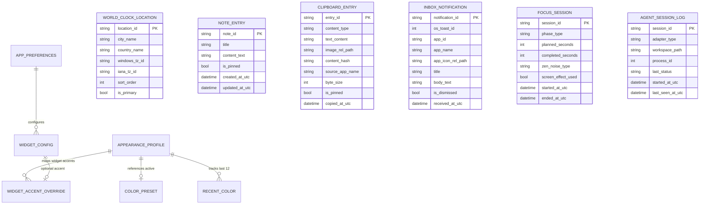

# Data Model & Local Persistence Specification: Shima

**Feature**: `001-shima-dynamic-island` | **Date**: `2026-11-21`  
**Storage Root**: `%LOCALAPPDATA%\Shima\` (User-only NTFS ACLs)

---

## 1. Storage Architecture Decision

Shima splits local persistence across two complementary engines inside `%LOCALAPPDATA%\Shima\`:

1. **SQLite 3 (`Microsoft.Data.Sqlite`, WAL mode)** at `data/shima.db`:
   - Stores high-churn, queryable, timestamped, and retention-bounded collections: **Notes**, **Clipboard History**, **Notification Inbox**, **Focus Timer Sessions**, **World Clock Locations**, **Widget Configurations**, and **Developer Agent Session Logs**.
   - *Justification*: Zero-config embedded ACID engine, fast indexed substring search (`LIKE` / FTS5), concurrent non-blocking reads during writes via `WAL`, and deterministic schema migrations via `PRAGMA user_version` / migration table.
2. **Atomic Versioned JSON (`System.Text.Json`)** at `config/`:
   - `config/settings.json`: General app preferences, startup/monitor/fullscreen rules, hotkeys, and active license metadata.
   - `config/appearance.json`: Active island appearance profile (6 color tokens, collapsed/expanded linking, per-widget accent map, active preset ID).
   - `config/presets.json`: User-created custom appearance presets and the 12-slot `RecentlyUsedColors` FIFO ring buffer.
   - `config/runtime-journal.json`: Lightweight crash-recovery flag (e.g., `ZenDisplayEffectActive`, `LastExitClean`).
   - *Justification*: Human-inspectable, instantly loaded at cold start (`< 5 ms` before SQLite connection even opens), atomic `File.Replace` updates prevent partial-write corruption, and zero DB write overhead during live Color Picker scrubbing.

---

## 2. Entity-Relationship Diagram



---

## 3. Relational Database Schema (`shima.db`)

### 3.1 `schema_migrations`
| Field | Type | Constraints | Description |
| :--- | :--- | :--- | :--- |
| `version` | `INTEGER` | `PK` | Monotonic migration version (`1, 2, ...`). |
| `applied_at_utc` | `TEXT` | `NOT NULL` | ISO-8601 UTC timestamp. |

### 3.2 `widget_configs`
| Field | Type | Constraints | Description |
| :--- | :--- | :--- | :--- |
| `widget_id` | `TEXT` | `PK` | Canonical immutable widget ID (`shima.clock`, `shima.music`, etc.). |
| `is_enabled` | `INTEGER` | `NOT NULL DEFAULT 1` | Boolean (`0` or `1`). |
| `sort_order` | `INTEGER` | `NOT NULL` | Zero-based display order in 8-dot carousel (`>= 0`). |
| `allow_peek_notifications` | `INTEGER` | `NOT NULL DEFAULT 1` | Whether widget may trigger `Notification` or `Active` island states. |
| `settings_json` | `TEXT` | `NOT NULL DEFAULT '{}'` | Validated widget-specific JSON payload. |
| `updated_at_utc` | `TEXT` | `NOT NULL` | Last modification timestamp. |

### 3.3 `world_clock_locations`
| Field | Type | Constraints | Description |
| :--- | :--- | :--- | :--- |
| `location_id` | `TEXT` | `PK` | UUID v4 string. |
| `city_name` | `TEXT` | `NOT NULL, LEN 1..80` | Display name (e.g., `Manila`, `London`). |
| `country_name` | `TEXT` | `NOT NULL, LEN 0..80` | Optional region/country label. |
| `windows_tz_id` | `TEXT` | `NOT NULL` | Validated against `TimeZoneInfo.FindSystemTimeZoneById`. |
| `iana_tz_id` | `TEXT` | `NOT NULL` | Canonical IANA ID (e.g., `Asia/Manila`). |
| `sort_order` | `INTEGER` | `NOT NULL` | Display sequence in right column. |
| `is_primary` | `INTEGER` | `NOT NULL DEFAULT 0` | Currently selected primary clock city (`1` for active). |

### 3.4 `notes`
| Field | Type | Constraints | Description |
| :--- | :--- | :--- | :--- |
| `note_id` | `TEXT` | `PK` | UUID v4 string. |
| `title` | `TEXT` | `NOT NULL, LEN 0..120` | Auto-derived from first line if omitted. |
| `content_text` | `TEXT` | `NOT NULL, LEN <= 200000` | Plaintext/markdown note content (capped at 200 KB/note). |
| `is_pinned` | `INTEGER` | `NOT NULL DEFAULT 0` | Keeps note at top of list. |
| `created_at_utc` | `TEXT` | `NOT NULL` | ISO-8601 UTC creation time. |
| `updated_at_utc` | `TEXT` | `NOT NULL` | Indexed descending for recent sort. |

### 3.5 `clipboard_entries`
| Field | Type | Constraints | Description |
| :--- | :--- | :--- | :--- |
| `entry_id` | `TEXT` | `PK` | UUID v4 string. |
| `content_type` | `TEXT` | `NOT NULL, CHECK IN ('Text','Image')` | Payload type. |
| `text_content` | `TEXT` | `NULL, LEN <= 1048576` | Captured text (max 1 MB by default). |
| `image_rel_path` | `TEXT` | `NULL` | Relative path inside `%LOCALAPPDATA%\Shima\cache\clip\` (PNG thumbnail/bitmap). |
| `content_hash` | `TEXT` | `NOT NULL` | SHA-256 hex digest for consecutive deduplication. |
| `source_app_name` | `TEXT` | `NULL, LEN <= 128` | Foreground window process name at copy time. |
| `byte_size` | `INTEGER` | `NOT NULL, CHECK >= 0` | Payload size in bytes. |
| `is_pinned` | `INTEGER` | `NOT NULL DEFAULT 0` | Exempt from retention pruning & unpinned clear. |
| `copied_at_utc` | `TEXT` | `NOT NULL` | Indexed descending (`idx_clipboard_copied_at`). |

### 3.6 `inbox_notifications`
| Field | Type | Constraints | Description |
| :--- | :--- | :--- | :--- |
| `notification_id` | `TEXT` | `PK` | UUID v4 string. |
| `os_toast_id` | `INTEGER` | `NULL` | Windows `UserNotification.Id` for Action Center bidirectional dismissal. |
| `app_id` | `TEXT` | `NOT NULL` | OS AppUserModelID or normalized app identifier. |
| `app_name` | `TEXT` | `NOT NULL, LEN 1..128` | Grouping label in Inbox UI. |
| `app_icon_rel_path` | `TEXT` | `NULL` | Cached app logo under `cache\icons\`. |
| `title` | `TEXT` | `NOT NULL, LEN <= 512` | Notification heading. |
| `body_text` | `TEXT` | `NOT NULL, LEN <= 4096` | Notification body snippet. |
| `is_dismissed` | `INTEGER` | `NOT NULL DEFAULT 0` | Soft-dismissed or purged state. |
| `received_at_utc` | `TEXT` | `NOT NULL` | Indexed descending (`idx_inbox_received_at`). |

### 3.7 `focus_sessions`
| Field | Type | Constraints | Description |
| :--- | :--- | :--- | :--- |
| `session_id` | `TEXT` | `PK` | UUID v4 string. |
| `phase_type` | `TEXT` | `NOT NULL, CHECK IN ('Work','ShortBreak','LongBreak')` | Session phase. |
| `planned_seconds` | `INTEGER` | `NOT NULL, CHECK > 0` | Configured duration. |
| `completed_seconds` | `INTEGER` | `NOT NULL, CHECK >= 0` | Actual elapsed seconds. |
| `zen_noise_type` | `TEXT` | `NOT NULL, CHECK IN ('None','White','Pink','Brown')` | Ambient audio used. |
| `screen_effect_used` | `INTEGER` | `NOT NULL DEFAULT 0` | Whether grayscale/dimming ran. |
| `started_at_utc` | `TEXT` | `NOT NULL` | Start timestamp. |
| `ended_at_utc` | `TEXT` | `NULL` | Completion or cancellation timestamp. |

### 3.8 `agent_session_logs` *(Phase 2)*
| Field | Type | Constraints | Description |
| :--- | :--- | :--- | :--- |
| `session_id` | `TEXT` | `PK` | Adapter-scoped session identifier (`adapter:raw_session_id`). |
| `adapter_type` | `TEXT` | `NOT NULL, CHECK IN ('ClaudeCode','OpenCode')` | Source adapter. |
| `workspace_path` | `TEXT` | `NOT NULL` | Working directory reported by agent. |
| `process_id` | `INTEGER` | `NULL` | Terminal/agent PID for focus & exit tracking. |
| `last_status` | `TEXT` | `NOT NULL, CHECK IN ('Working','NeedsAttention','AwaitingApproval','Finished')` | Canonical normalized state. |
| `started_at_utc` | `TEXT` | `NOT NULL` | First event timestamp. |
| `last_seen_at_utc` | `TEXT` | `NOT NULL` | Last event timestamp. |

---

## 4. JSON Configuration Schemas (Appearance, Presets & App Preferences)

### 4.1 `appearance.json` (`AppearanceConfiguration`)

```json
{
  "schemaVersion": 1,
  "activePresetId": "builtin.midnight",
  "linkCollapsedAndExpanded": true,
  "usePerWidgetAccents": false,
  "collapsedTokens": {
    "backgroundHex": "#000000",
    "accentHex": "#FFFFFF",
    "borderHex": "#1F1F24",
    "glowHex": "#000000",
    "primaryTextHex": "#F8FAFC",
    "secondaryIconHex": "#94A3B8"
  },
  "expandedTokens": {
    "backgroundHex": "#000000",
    "accentHex": "#FFFFFF",
    "borderHex": "#1F1F24",
    "glowHex": "#000000",
    "primaryTextHex": "#F8FAFC",
    "secondaryIconHex": "#94A3B8"
  },
  "glowOpacity": 0.45,
  "borderThicknessDip": 1.0,
  "perWidgetAccents": {
    "shima.music": "#34D399",
    "shima.focus": "#FB923C",
    "shima.developer": "#38BDF8"
  }
}
```

### 4.2 `presets.json` (`PresetCatalog`)

| Entity / Field | Type & Validation | Rules |
| :--- | :--- | :--- |
| `customPresets[]` | Array of `ColorPreset` | `presetId` (UUID), `name` (1–40 chars, unique case-insensitive, trimmed), `isBuiltIn = false`, `collapsedTokens`, `expandedTokens`, `createdAtUtc`, `updatedAtUtc`. Built-in presets (`Midnight`, `Snow`, `Ocean`, `Lavender`, `Emerald`, `Sunset`) are immutable in code and merged at runtime. |
| `savedSwatches[]` | Array of `SavedColorSwatch` | `swatchId`, `label` (1–32 chars), `hex` (`^#[0-9A-F]{6}$`). |
| `recentColors[]` | Array of `#RRGGBB` strings | Max length `12`; FIFO deduplicated (re-selecting moves hex to index `0`). Only updated on confirmed `Apply / OK`, never during live preview scrubbing. |

### 4.3 `settings.json` (`AppPreferences`)

Includes:
- `schemaVersion` (`int`), `startWithWindows` (`bool`), `targetMonitorMode` (`Primary | ActiveCursor | SpecificMonitorId`), `specificMonitorDeviceId` (`string?`), `expandOnHover` (`bool`), `hoverExpandDelayMs` (`100..1500`, default `350`), `autoCollapseDelayMs` (`200..3000`, default `450`), `globalToggleHotkey` (`KeyGesture`), `fullscreenBreakthroughAlerts` (`bool`, default `false` per `FR-SHELL-007`), `syncInboxDismissalWithActionCenter` (`bool`, default `true` per `FR-INBOX-003`), `clipboardMaxItems` (`20..1000`, default `100`), `clipboardRetentionDays` (`1..365`, default `30`), `inboxRetentionDays` (`1..90`, default `14`), `claudeCodeOptInEnabled` (`bool`), `openCodeOptInEnabled` (`bool`), `openCodeEndpointUrl` (`string`, validated `http://localhost:*` or `http://127.0.0.1:*`), `openCodeServerPassword` (`dpapiEncryptedBlob?`, optional `DataProtectionScope.CurrentUser` password for authenticated `opencode serve` loopback endpoints; `null` when unauthenticated; never serialized in plaintext or logged), `updatesOfflineMode` (`bool`, default `false`), `licenseState` (`dpapiEncryptedBlob?`).

---

## 5. Validation, Retention & Migration Strategy

- **Color Normalization**: All persisted hex tokens MUST match uppercase `^#[0-9A-F]{6}$`. Any corrupt or unparseable JSON field falls back safely to the `Midnight` built-in default for that token while backing up the corrupt file as `*.corrupt.<timestamp>.json`.
- **Retention Policies**:
  - **Clipboard**: Prunes unpinned entries older than `clipboardRetentionDays` or exceeding `clipboardMaxItems` on startup and after every 25th insertion (deleting associated image files in `cache\clip\`). Pinned items are exempt.
  - **Inbox**: Prunes notifications older than `inboxRetentionDays` and caps total stored items at `500`.
  - **Agent Session Logs**: Active UI collapsed bar holds `Finished` for `10s` (or until hovered/opened) and holds `Error / Failed` until hovered/dismissed (`15m` max auto-expiry), suspending timers once `Idle`; expanded multi-session list retains finished/errored rows for `15m` (or until dismissed); SQLite `agent_session_logs` keeps active sessions + last `50` finished sessions.
- **Migration Strategy (Surviving App Updates & Restarts)**:
  - `%LOCALAPPDATA%\Shima\` resides outside the Velopack/application binary directory (`%LOCALAPPDATA%\Shima\app-*`), guaranteeing user configs, notes, and custom presets are untouched during updates or binary swaps.
  - On startup, `MigrationRunner` runs forward-only additive SQLite migrations inside a single transaction (`BEGIN IMMEDIATE ... COMMIT`) and upgrades JSON `schemaVersion` via backward-compatible property defaults (`System.Text.Json` never deletes unknown forward fields during downgrade safety).
