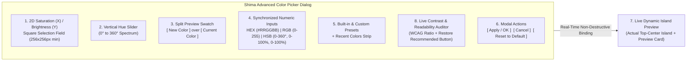

# Feature Specification: Shima — Windows Dynamic Island Desktop Companion

**Feature Branch**: `001-shima-dynamic-island`

**Created**: 2026-11-21

**Status**: Draft

**Input**: Comprehensive product and reverse-engineering specification for **Shima**, an independent Windows Dynamic Island desktop companion inspired by publicly observable behaviors of Navisle (`https://navisle.com/`) and governed by the Shima Engineering Constitution v1.0.0.

---

## 1. Product Identity, Vision & Overview

### 1.1 Product Identity

- **Product Name**: Shima
- **Product Category**: Windows Desktop Companion / Dynamic Island System Overlay
- **Target Operating System**: Windows 10 (version 20H2 / build 19042+) and Windows 11 (x64 and ARM64)
- **Independence Statement**: Shima is an independently engineered desktop product. Navisle (`https://navisle.com/`) serves strictly as an external behavioral and UX reference for feature discovery. Shima does not reuse proprietary code, branding, assets, or commercial payment infrastructure from Navisle.

### 1.2 Product Vision

Shima introduces a sleek, top-centered Dynamic Island interface to the Windows desktop that behaves as a natural extension of the operating system shell rather than a traditional windowed application. When idle, Shima rests unobtrusively at the top-center edge of the display with near-zero resource consumption. When the user interacts with it or relevant system events occur (media track changes, incoming notifications, timer completions, or coding-agent prompts), Shima smoothly expands to provide immediate access to 8 modular utilities: **Clock**, **Now Playing**, **Focus Timer**, **Notes**, **Inbox**, **Clipboard**, **Volume Mixer**, and **Developer Activity**.

### 1.3 Target Users & Core Use Cases

| User Persona | Primary Needs | Key Shima Use Cases |
| :--- | :--- | :--- |
| **Power Desktop Users & Multitaskers** | Fast access to media, volume mixer, clipboard history, and notifications without leaving the active window or cluttering the taskbar. | Adjusting per-app audio levels during a call, re-copying recent clipboard snippets, skipping tracks, and triaging missed notifications from a single top-edge gesture. |
| **Knowledge Workers & Deep-Focus Professionals** | Structured focus sessions, distraction suppression, quick scratchpad notes, and world time awareness across remote teams. | Running Pomodoro timers with Zen ambient noise and grayscale display dimming, jotting instant self-saving notes, and checking time offsets across Manila, London, New York, and Tokyo. |
| **Software Engineers & AI-Assisted Developers** | Real-time visibility into terminal coding agents (Claude Code, OpenCode) while browsing docs or reviewing code in other windows. | Receiving instant island alerts when a coding agent awaits tool execution approval, and clicking **Allow** or **Deny** directly from the top of the screen without switching windows. |
| **Aesthetic & Customization Enthusiasts** | Precision control over desktop chrome, color harmony, and smooth animations that match personalized wallpapers and themes. | Designing custom island palettes using a Photoshop-grade 2D HSB/RGB/HEX color picker with live non-destructive island preview and reusable theme presets. |

### 1.4 Product Scope & Phased Prioritization

#### Phase 1: MVP (Core Product Foundation)

- Core Dynamic Island shell (`Collapsed`, `Expanded`, `Notification`, `Active`, `Idle`, `Fullscreen`, and `Maximized Window` states).
- Multi-monitor anchoring, Per-Monitor DPI v2 scaling, keyboard navigation, and reduced-motion accessibility.
- Centralized Widget Registry & plugin lifecycle (`Enable`, `Disable`, `Reorder`, `Configure`, `Reset`).
- **7 Core Everyday Widgets**:
  1. **Clock** (Local time, date, UTC offset, multi-city world clock selector).
  2. **Now Playing** (Windows media session detection, track metadata, artwork, playback & seek controls, live visualizer/progress).
  3. **Focus Timer** (Pomodoro & custom intervals, work/short-break/long-break, Zen mode with white/pink/brown noise, safe display dimming/grayscale with crash-safe recovery).
  4. **Notes** (Multi-note auto-saving local scratchpad with instant search).
  5. **Inbox** (Local Windows notification capture, per-app grouping, dismissal, DND awareness).
  6. **Clipboard** (Local text & image clipboard history, one-click recopy, pin, search, pause, clear, sensitive password exclusion).
  7. **Volume Mixer** (Active application audio sessions, per-app volume sliders, mute/unmute, bidirectional Windows audio sync).
- **Settings Application & Appearance System**:
  - Dedicated sidebar navigation (`General`, `Widgets`, `Notifications`, `Clipboard`, `Focus Timer`, `Clock`, `Developer Integrations`, `Appearance & Customization`, `Updates`, `License`).
  - Island appearance customization (`Background`, `Accent`, `Border`, `Highlight/Glow`, `Text`, `Icon` colors for collapsed/expanded states).
  - **Advanced Color Picker** (Photoshop 22.3.0 functional reference: 2D Saturation/Brightness field, 0–360° vertical Hue slider, Current vs. New split swatch, synchronized `HEX` / `RGB` / `HSB` inputs, 6 built-in presets, custom user presets, recent colors, live non-destructive island preview, WCAG contrast warning & auto-fix, persistent local storage).

#### Phase 2: Developer Ecosystem & Deep Customization

- **8. Developer Activity Widget**:
  - Extensible coding-agent adapter framework (`ICodingAgentAdapter`).
  - Independent **Claude Code Adapter** (hook/IPC event listener, session state tracking: `Working`, `Needs attention`, `Awaiting approval`, `Finished`, and interactive `Allow` / `Deny` actions).
  - Independent **OpenCode Adapter** (local event/log/process integration with documented capability boundaries).
- Per-widget accent color overrides and advanced appearance preset import/export.
- Global customizable hotkeys per widget and advanced media/mixer controls (audio output device switching, microphone mute indicator).

#### Phase 3: Extensibility & Advanced Visuals

- Sandboxed third-party widget plugin SDK and schema-driven custom widgets.
- Multi-island support (simultaneous islands on secondary monitors).
- Optional shader/backdrop effects (Acrylic/Mica/ambient album-art tinting) gated by battery and GPU performance budgets.

---

## Clarifications

### Session 2026-11-21

- Q: While the Advanced Color Picker is open, how should live preview display on the Dynamic Island and how should low-contrast readability warnings be enforced on save? (FR-PICKER-006) → A: Auto-pin the actual Dynamic Island open while the Color Picker is active with a toggle between Collapsed and Expanded preview states; update island colors in real time; display low-contrast warnings (`< 4.5:1` text / `< 3.0:1` icons) as non-blocking advisory alerts that still allow `Apply / OK` alongside a one-click `Restore Recommended Contrast` button; restore normal auto-collapse behavior when the Color Picker closes.
- Q: When a fullscreen application, video, or game is active on the island's monitor, how should Shima hide itself, handle incoming alerts, and let the user summon the island? (FR-SHELL-007) → A: Hide the island completely and disable top-edge hover hit-testing during fullscreen; queue standard notifications silently to Inbox; summon only via a configurable global hotkey (with an optional setting allowing critical Focus Timer completions or Coding-Agent approval prompts to break through borderless fullscreen).
- Q: How should Shima handle Windows notification permission/non-native toast boundaries and notification dismissal between Shima's Inbox and Windows Action Center? (FR-INBOX-003) → A: Restrict Inbox strictly to the native Windows notification API (no window scraping of custom popups); display a graceful status card with a Windows Settings link when listener access or package identity is unavailable; synchronize notification dismissals bidirectionally with Windows Action Center by default (with a user setting for local-only Inbox dismissal).
- Q: How should Shima register coding-agent integrations (Claude Code and OpenCode) and behave if Shima is closed, unresponsive, or disconnected while an agent awaits approval? (FR-DEV-003) → A: Keep Claude Code and OpenCode integrations strictly opt-in from Developer Integrations Settings (explicit hook install/uninstall and explicit endpoint/plugin configuration, with zero silent config edits or background port scanning), and enforce a fail-open passthrough contract so any closed pipe, timeout, or disconnect falls back to the agent's native terminal prompt without hanging or auto-denying.
- Q: Inside the Advanced Color Picker dialog, what should clicking Reset to Default reset and should it stage into Live Preview or save to disk immediately? (FR-PICKER-006) → A: Inside the Color Picker dialog, `Reset to Default` resets only the currently edited color slot to its `Midnight` factory default inside Live Preview (remaining reversible via `Cancel` and requiring `Apply / OK` to persist), while a separate `Reset All Appearance` button on the main Appearance Settings page restores all 6 island color tokens to `Midnight` defaults.

### Session 2026-11-22

- Q: When Developer Activity is enabled, when should the collapsed notch show the thin horizontal status bar, and how should it coexist with other active widgets like Now Playing or Focus Timer? (FR-DEV-006) → A: Show the muted gray `Idle` bar whenever Claude Code or OpenCode is opted in (and pure black pill only when Developer Activity is disabled/unconfigured); in the compact pill, prioritize `Awaiting approval` / `Needs attention` above Now Playing and Focus Timer, while `Working` / `Finished` share or yield to active Focus Timer or Now Playing.
- Q: When the collapsed notch is displaying a coding-agent status bar and the user hovers or clicks to expand the island, which widget should open first, and what should clicking a non-approval session row do? (FR-DEV-006) → A: When at least one coding-agent session is active or awaiting attention, expanding opens directly to **Developer Activity** (when `Idle`, expanding opens the user's last active/default widget such as Clock); clicking a non-approval session row focuses its terminal window when `SupportsTerminalFocus` is true.
- Q: After the last active coding-agent session finishes (`Finished` full green) or fails (`Error / Failed` full red/coral), how long should that status remain on the collapsed bar and in the expanded list before returning to `Idle`? (FR-DEV-006) → A: Hold `Finished` (full green) on the collapsed bar for `10 seconds` (or until hovered/opened), then revert the bar to `Idle` gray while keeping finished rows in the expanded list for `15 minutes` (or until dismissed); hold `Error / Failed` (full red/coral) on the bar until hovered/dismissed (max `15 minutes` auto-expiry).
- Q: When OpenCode presents an actionable permission request, which approval verdicts should Shima expose on the session row? (FR-DEV-003) → A: Expose only **Allow** (strictly mapped to single-action `once`, never `always` implicitly) and **Deny** (`reject`) inline on actionable rows, leaving session-wide `always` rules inside OpenCode's native terminal.
- Q: If a user runs `opencode serve` with local authentication enabled (such as `OPENCODE_SERVER_PASSWORD`), how should Shima handle authentication when connecting to the loopback OpenCode endpoint? (FR-DEV-002) → A: Support an optional local server password in Developer Integrations Settings stored locally with Windows DPAPI (`DataProtectionScope.CurrentUser`), defaulting to unauthenticated loopback when blank and surfacing an explicit `Authentication required` health status on HTTP `401`.

---

## 2. User Scenarios & Testing *(mandatory)*

### User Story 1 - Dynamic Island Shell & Context-Aware State Transitions (Priority: P1)

As a Windows user, I want a lightweight top-center Dynamic Island that stays compact while I work, smoothly expands when I interact with it or when an event occurs, and automatically gets out of the way during fullscreen games or videos.

**Why this priority**: The Island shell is the host container and primary interaction surface for every widget and system notification; without deterministic window positioning, DPI scaling, and state transitions, no widget can function reliably.

**Independent Test**: Launch Shima on single- and multi-monitor Windows setups at 100%–200% DPI scaling; verify collapsed resting position, click/hover expansion, pagination across enabled widgets, fullscreen auto-hide, and 0% idle CPU usage when collapsed.

**Acceptance Scenarios**:

1. **Given** Shima is running and no background activity is active, **When** the user is working in standard desktop applications, **Then** Shima renders in the **Collapsed** state anchored flush to the top-center edge of the configured display (`Y = 0`) with concave top ear fillets and consumes `< 0.5%` CPU (`0.0%` steady state).
2. **Given** Shima is in the **Collapsed** or **Active** state, **When** the user clicks the island (or triggers the expand shortcut/hover threshold), **Then** the island smoothly morphs into the **Expanded** state within `250 ms` without stealing keyboard focus from the foreground window unless a text input field inside the island is explicitly clicked.
3. **Given** Shima is in the **Expanded** state, **When** the user clicks the vertical pagination dots, scrolls the mouse wheel over the pager, or uses keyboard navigation (`Tab`, `Left/Right` or `Up/Down` arrows), **Then** the viewport switches smoothly between enabled widgets and updates the active pagination dot.
4. **Given** a foreground application enters exclusive fullscreen or borderless fullscreen video/game mode on the island's monitor, **When** fullscreen occupancy is detected, **Then** Shima hides completely and disables its top-edge hover hit-box within `500 ms`, silently queues standard notifications to the Inbox, and remains summonable via a configurable global shortcut (with an optional setting to let critical Focus Timer completions or Coding-Agent approval alerts peek over borderless fullscreen windows).
5. **Given** a standard application window (such as a web browser or IDE) is maximized on the desktop, **When** the user interacts with the maximized application's title bar, tabs, or window controls, **Then** the collapsed island's bounding box and hit-test region do not block standard window close/maximize/minimize buttons or tab switching outside the compact island pill footprint.

---

### User Story 2 - World Clock & Timezone Management (Priority: P1)

As a user working across timezones, I want to view my current local time, date, and UTC offset alongside a customizable list of world cities inside the island so I can check international times at a glance.

**Why this priority**: The Clock widget is the default primary home view of the Dynamic Island (as shown in the reference screenshot) and provides immediate utility with zero external setup.

**Independent Test**: Expand the island to the Clock widget, verify the two-column layout (date, large time, city/UTC offset on the left; selectable city list and settings gear icon on the right), add/remove/reorder cities, and toggle 12-hour/24-hour formats.

**Acceptance Scenarios**:

1. **Given** the Clock widget is active in the **Expanded** state, **When** the user views the island, **Then** the left column displays the formatted day and date (e.g., `Saturday, November 21`), large current time (`9:15 PM`), and selected city with UTC offset (`Manila · UTC+8`), while the right column displays the configured list of world cities with a bullet indicator next to the selected city and a Settings gear icon (`⚙`).
2. **Given** multiple cities are configured in the Clock widget, **When** the user clicks a different city in the right-hand list (e.g., `London`, `New York`, or `Tokyo`), **Then** the primary time readout and UTC offset on the left immediately update to reflect that city's current local time and date.
3. **Given** the user opens Clock Settings, **When** the user adds a city, removes an existing city, reorders the city list, or toggles between 12-hour (`AM/PM`) and 24-hour time formats, **Then** the Clock widget immediately reflects the new order and format and persists the configuration across application restarts.

---

### User Story 3 - Now Playing Media Control & Volume Mixer (Priority: P1)

As a desktop listener, I want to see the currently playing track, album art, and progress inside the island—and independently adjust individual application volumes—so I can control all desktop audio from one place.

**Why this priority**: Media playback and per-application volume mixing are among the most frequent daily desktop interactions and take direct advantage of the Dynamic Island's `Active` and `Expanded` states.

**Independent Test**: Play audio in a supported Windows media application (e.g., Spotify, browser, or media player) and run a second audio-producing app; verify track metadata, artwork, play/pause/skip/seek controls in **Now Playing**, and verify independent per-app volume sliders and mute toggles in **Volume Mixer**.

**Acceptance Scenarios**:

1. **Given** a Windows application starts playing media exposed via Windows system media controls, **When** the island is collapsed, **Then** the island transitions to the **Active** compact state displaying a subtle playback indicator or artwork badge; when expanded to **Now Playing**, it displays track title, artist, album artwork, playback progress/live audio meter, and play/pause/previous/next controls.
2. **Given** a media session does not provide album artwork or seek capability, **When** the **Now Playing** widget renders, **Then** it displays a clean themed fallback icon and disables or hides the seek bar without errors or layout breakage.
3. **Given** multiple applications have active audio output sessions in Windows, **When** the user switches to the **Volume Mixer** widget, **Then** each active application is listed with its app icon/name, an independent volume slider (`0–100%`), and a mute/unmute toggle that updates Windows audio levels in real time and reflects volume changes made externally in Windows.

---

### User Story 4 - Clipboard History, Quick Notes & Notification Inbox (Priority: P1)

As a productivity-focused user, I want my copied clipboard items, quick scratchpad notes, and recent Windows notifications captured locally inside the island so I can retrieve information anytime without cloud accounts or privacy leaks.

**Why this priority**: Local capture of transient workspace data (clipboard, quick thoughts, missed toasts) eliminates context switching while upholding Shima's local-first privacy guarantee.

**Independent Test**: Copy text and an image to the Windows clipboard, write a multi-line note in the Notes widget, and trigger a Windows notification; verify local persistence, search, pinning, recopying, and notification grouping by app with zero outbound network traffic.

**Acceptance Scenarios**:

1. **Given** clipboard monitoring is active, **When** the user copies text or an image in any application, **Then** the entry appears at the top of the **Clipboard** widget history; clicking the entry copies it back to the system clipboard immediately.
2. **Given** the user pins a clipboard entry or pauses clipboard collection, **When** the user clicks "Clear unpinned history" or copies sensitive content while paused, **Then** pinned entries are preserved, paused copies are ignored, and clipboard items flagged by password managers as excluded/sensitive are not recorded.
3. **Given** the user opens the **Notes** widget and types or edits text across one or more notes, **When** the user stops typing or collapses the island, **Then** changes are saved automatically to local storage within `500 ms` and remain searchable and intact after restarting Shima.
4. **Given** Windows notifications arrive while Shima is running and Windows Do Not Disturb is off, **When** a notification is received, **Then** Shima shows a brief **Notification** preview in the island (unless suppressed by DND/Focus/Fullscreen) and stores the alert in the **Inbox** widget grouped by source application for review or dismissal.

---

### User Story 5 - Focus Timer & Zen Mode with Safe Display Restoration (Priority: P2)

As a deep-work user, I want a configurable Pomodoro and Focus Timer with optional Zen ambient noise (white, pink, brown) and optional screen dimming/grayscale effects that always restore my display safely even if the app crashes.

**Why this priority**: Combines visual timer tracking in the island's `Active` state with immersive environment controls that differentiate Shima from basic countdown timers.

**Independent Test**: Start a Focus Timer session with Zen Mode enabled (ambient noise + display grayscale/dimming), pause/resume/reset the session, and simulate an unexpected process termination to verify the display filter/gamma is deterministically restored to original user settings.

**Acceptance Scenarios**:

1. **Given** the user configures work, short-break, and long-break durations in the **Focus Timer** widget, **When** a session is started, **Then** the island displays live countdown progress in both the **Expanded** view and the compact **Active** island state, and triggers an alert when the phase completes.
2. **Given** the user enables **Zen Mode** during a focus session, **When** the user selects white, pink, or brown noise and optional ambient screen dimming/grayscale, **Then** Shima plays smooth loopable local ambient audio and applies the display effect for the duration of the active focus phase.
3. **Given** an ambient screen effect (grayscale or dimming) is active, **When** the user pauses/stops Zen mode, exits Shima, or Shima recovers from an abnormal termination on next startup, **Then** the user's original Windows display color filter and brightness/gamma settings are restored completely without requiring manual OS settings repair.

---

### User Story 6 - Advanced Photoshop-Inspired Color Picker & Live Appearance Customization (Priority: P1)

As a user customizing my desktop, I want to personalize every island color property using an advanced color picker (with a 2D saturation/brightness square, vertical hue slider, synchronized HEX/RGB/HSB inputs, Current vs. New swatch comparison, presets, contrast warnings, and a live preview on the island) that only commits changes when I click Apply.

**Why this priority**: Appearance customization and the dedicated Advanced Color Picker are core differentiating requirements explicitly prioritized for MVP delivery.

**Independent Test**: Open Settings → Appearance & Customization, launch the Advanced Color Picker for any island color slot, manipulate the 2D gradient, vertical Hue slider, and HEX/RGB/HSB inputs, verify live preview on the actual Dynamic Island, test Cancel rollback vs. Apply persistence, verify low-contrast warnings, and save a custom preset.

**Acceptance Scenarios**:

1. **Given** the user opens the Advanced Color Picker for an island property (Background, Accent, Border, Highlight/Glow, Text, or Icon color), **When** the user drags the indicator inside the 2D Saturation/Brightness field or adjusts the vertical `0–360°` Hue slider, **Then** the **New Color** preview swatch, all numeric fields (`#RRGGBB`, `R/G/B 0–255`, `H 0–360° / S 0–100% / B 0–100%`), and the **Live Dynamic Island Preview** update in real time at interactive frame rates while the **Current Color** swatch remains unchanged.
2. **Given** the user manually types a valid value into any numeric field (`HEX`, `RGB`, or `HSB`), **When** the input changes, **Then** all other color representations, the 2D field indicator, and the Hue slider synchronize immediately; if an invalid value is entered, the field rejects or clamps the input gracefully without crashing or corrupting the current selection.
3. **Given** the user selects a text/icon and background color combination that falls below minimum readability contrast thresholds (WCAG AA `< 4.5:1` for normal text or `< 3.0:1` for icons/large text), **When** the color is previewed, **Then** the UI displays a clear readability warning badge with a one-click **"Restore Recommended Contrast"** action.
4. **Given** the user has adjusted colors in the live preview or selected one of the built-in presets (`Midnight`, `Snow`, `Ocean`, `Lavender`, `Emerald`, `Sunset`), **When** the user clicks **Cancel**, **Then** the live island immediately reverts to the previously applied appearance; **When** the user clicks **Apply / OK**, **Then** the new configuration is persisted locally and survives application restarts, Windows reboots, updates, and widget toggling.

---

### User Story 7 - Developer Activity Widget for Coding Agents (Priority: P2 — Phase 2)

As a software engineer using terminal AI coding agents (Claude Code, OpenCode), I want the Dynamic Island to display isolated, live agent session states (`Working`, `Needs attention`, `Awaiting approval`, `Finished`), active task details, and pending permission requests—and let me act on supported approval requests directly from the island with confirmed results.

**Why this priority**: Eliminates constant terminal polling and window switching during agent-assisted development while isolating Claude Code and OpenCode behind independent adapters with explicit capability boundaries.

**Independent Test**: Connect the independent Claude Code adapter and OpenCode adapter against their respective verified event surfaces; exercise concurrent multi-session updates across all 4 unified states (`Working`, `Needs attention`, `Awaiting approval`, `Finished`), reconnect/duplicate/missed-event recovery, disconnected session handling, and confirmed-only **Allow** / **Deny** execution (never simulating approval when unsupported or unconfirmed).

**Acceptance Scenarios**:

1. **Given** an OpenCode or Claude Code session connects via its independent opt-in adapter, **When** session creation, tool activity, errors/issues, pending permissions, or completion events arrive through the agent's supported documented event/API/hook channel, **Then** Shima normalizes the session cleanly into **Working**, **Needs attention**, **Awaiting approval**, or **Finished** and displays the active session, relevant task info, current state, and any pending permission request inside the **Developer Activity** widget and compact **Active** indicator.
2. **Given** an agent session presents a supported, actionable permission request with a valid confirmation channel, **When** the user clicks **Allow** or **Deny**, **Then** Shima sends the decision to the agent and updates the reflected decision state in Shima **only after** OpenCode/Claude Code confirms the action (never simulating approval or bypassing the agent's permission system).
3. **Given** OpenCode does not expose an actionable permission reply hook/API for the active session, or a session disconnects/becomes unavailable, **When** Shima renders that session, **Then** non-supported **Allow** / **Deny** buttons are omitted or disabled, unsupported OpenCode capabilities are clearly reflected rather than assumed, disconnected/unavailable states are handled gracefully, and the **Focus Terminal** action is shown only if supported.
4. **Given** multiple concurrent OpenCode and/or Claude Code sessions are active, or the OpenCode event stream experiences reconnects, duplicate deliveries, missed events, or inactive sessions, **When** events settle or the stream reconnects, **Then** each session remains isolated without mixed states or cross-session approval leakage, missed transitions are reconciled from documented session status queries, and Claude Code and OpenCode operate independently of one another.

---

### Edge Cases

- **Multi-Monitor Disconnect & Topology Change**: What happens when the monitor hosting Shima is unplugged, powered off, or its primary designation changes? Shima MUST intercept display topology events and automatically re-anchor to the new primary monitor within `500 ms` without rendering off-screen.
- **Dynamic Per-Monitor DPI Scaling Change**: What happens when the user changes Windows display scaling (e.g., from `100%` to `150%` or `200%`) while Shima is running? Shima MUST recalculate window bounds, concave ear geometry, font sizes, and hit-test regions dynamically without blurry bitmap stretching or clipped controls.
- **Maximized Window Title-Bar & Tab Collision**: How does Shima avoid blocking browser tabs or top-centered title-bar controls (such as VS Code command search box) in maximized windows? In the **Collapsed** state, Shima maintains a compact width and height footprint, supports an `Alt + hover` pass-through mode (temporarily hiding/unlocking click-through on the collapsed island for `3 seconds`), and allows users to configure collapsed dimensions or horizontal offset.
- **Non-Standard / Custom Third-Party Notifications**: What happens when applications (e.g., Slack, Discord, Steam, or custom Electron/Qt apps) bypass the Windows Notification Center and render their own custom popup windows? Shima's **Inbox** widget strictly monitors only the native Windows notification subsystem (never scraping other apps' windows via UI Automation) and explicitly documents in the UI and user guide that custom third-party popups are outside the OS notification stream.
- **Denied or Unavailable Windows Notification Listener Access**: How does Shima behave if the user or Windows Group Policy revokes notification access, or if running in an unpackaged context without `UserNotificationListener` app identity? The **Inbox** widget degrades gracefully to an informative status card with a direct shortcut to open Windows Notification/Privacy Settings (or configure packaged/identity prerequisites), while all other widgets continue operating normally.
- **Oversized or Sensitive Clipboard Payload**: What happens when a user copies a 500 MB bitmap, a file drop list, or a password from 1Password/Bitwarden/KeePass? Shima skips or downscales payloads exceeding configurable size limits (default: text `<= 1 MB`, image thumbnail/storage `<= 10 MB`), ignores clipboard entries carrying standard password-manager exclusion formats (`ExcludeClipboardContentFromMonitorProcessing`, `CanIncludeInClipboardHistory = 0`), and never blocks the OS clipboard chain.
- **Rapid Audio Session Churn**: What happens when short-lived processes (system sounds, notification chimes, CLI alerts) rapidly open and close Windows audio sessions? The **Volume Mixer** filters out transient system sound sessions or debounces session termination gracefully so slider rows do not flicker jitterily under the user's cursor.
- **Abnormal Termination During Zen Mode Screen Filter**: What happens if Shima is force-killed (`End Task`) or the PC loses power while a Zen Mode grayscale/dimming effect is applied? Shima records a "display-modified" recovery journal flag before applying any screen effect; upon next launch (or via a lightweight watchdog/cleanup hook), Shima automatically restores the user's original display state.
- **Corrupted Local Configuration or Database**: What happens if `settings.json` or the local SQLite database is corrupted by a power outage? Shima backs up the corrupted file with a `.corrupt.<timestamp>` suffix, initializes clean default settings/tables deterministically, and notifies the user non-intrusively without crashing on startup.
- **Coding-Agent Hook Timeout or Shima Closed Mid-Prompt**: What happens if a Claude Code or OpenCode hook fires while Shima is closed, unresponsive, or exited while an `Awaiting approval` prompt is open? The Shima bridge script detects the unreachable/broken IPC channel or configurable response timeout and fails open (returning passthrough to the agent's native terminal prompt) so the developer's session never hangs or silently auto-denies.

---

## 3. Reverse Engineering Analysis & Methodology

### 3.1 Evidence Classification Taxonomy

Every feature analysis and behavioral claim in this specification is classified into one of four strict categories:

- **`[CONFIRMED]`**: Directly verified from Navisle's public website (`navisle.com`), public Microsoft Store listing, FAQ, release descriptions, or the user-supplied reference screenshots.
- **`[INFERRED]`**: Logically deduced from observable UI behavior, standard Windows desktop conventions, or visual layout constraints in the reference screenshots.
- **`[PROPOSED]`**: An original architectural, UX, or feature engineering decision specifically designed for **Shima** (including the Photoshop-inspired Advanced Color Picker and dual Claude Code + OpenCode adapter architecture).
- **`[NEEDS VALIDATION]`**: Technical behaviors or third-party integration mechanisms that require empirical prototype testing on target Windows builds during Phase 0 of `/speckit-plan`.

---

### 3.2 Core Dynamic Island Shell & Interface States

#### Interface State Matrix

| State | Visual & Behavioral Definition | Entry Triggers | Exit Triggers | Evidence Tag |
| :--- | :--- | :--- | :--- | :--- |
| **1. Collapsed** | Compact pill anchored flush at `(CenterX, Top=0)` of target display with concave left/right top ear fillets (`r ≈ 14–18px`) and rounded bottom corners (`r ≈ 20–24px`). Minimal footprint; zero animations running. | Application startup; mouse leave / click outside from `Expanded`; completion of `Notification` preview when no background activity exists. | User click / hover activation; incoming notification; active background media/timer/agent activity; fullscreen entry. | `[CONFIRMED]` (Image 1) |
| **2. Expanded** | Full interactive panel (`~360–440px` wide, `~140–220px` tall depending on widget) with soft drop shadow, active widget viewport, and 8-dot vertical pagination indicator on the right inner bezel (`⋮`). | User clicks collapsed/active island; user clicks notification preview; user presses global expand hotkey. | Click outside island bounds; press `Esc`; mouse leaves island for configurable dwell duration (unless pinned or text input focused). | `[CONFIRMED]` (Image 2) |
| **3. Notification** | Temporary medium-sized expansion displaying source app icon, notification title/summary, and quick dismiss/action controls. | Windows notification arrives (while DND and fullscreen suppression are inactive) or coding agent requests attention. | Auto-dismiss timer expires (`4s` default) → returns to `Collapsed` or `Active`; user clicks preview → transitions to `Expanded` (Inbox or Developer widget). | `[CONFIRMED]` |
| **4. Active** | Slightly widened compact pill displaying live ambient telemetry (e.g., mini album art + animated equalizer bars for Now Playing, countdown text/ring for Focus Timer, or pulsing status dot for Coding Agent). | Media playback starts; Focus Timer session is running; Coding Agent session is `Working` or `Awaiting approval`. | Playback stops/pauses (after timeout); timer ends; agent finishes; user clicks pill to enter `Expanded`. | `[CONFIRMED]` / `[INFERRED]` |
| **5. Idle** | Internal resource-saving sub-state of `Collapsed` where all UI timers, composition animations, and non-essential background ticks are completely suspended (`0.0%` CPU/GPU). | Island remains in `Collapsed` state for `> 2s` with no active animations, or display turns off / Windows locks. | Any OS event callback (clipboard update, media change, toast arrival, user pointer enter). | `[CONFIRMED]` |
| **6. Fullscreen** | Island hides completely and disables its top-edge mouse hit-box so games, videos, and presentations are never disrupted by cursor hits at `Y = 0`. Standard notifications queue silently to Inbox. | Foreground window on the island's monitor occupies full monitor bounds (`SHQueryUserNotificationState` / fullscreen rect match). | Foreground fullscreen window exits, minimizes, or loses focus; user presses the global hotkey; or an optional critical breakthrough alert (Focus Timer completion / Coding-Agent approval) triggers over borderless fullscreen. | `[CONFIRMED]` / `[PROPOSED]` |
| **7. Maximized Windows** | Island remains visible in `Collapsed` or `Active` state over the top-center title bar area without interfering with standard window close/maximize/minimize buttons or normal app interaction. | Any standard desktop window is maximized (`WS_MAXIMIZE`). | User interacts with island (expands) or switches to a fullscreen app. | `[CONFIRMED]` |

#### Reverse Engineering Breakdown: Core Island Shell

1. **Observed Behavior**: `[CONFIRMED]` Image 1 shows a pure black top-centered notch seamlessly fused to the top edge of the monitor via concave top corners. Image 2 shows the expanded panel with a soft elevation shadow and an 8-dot vertical carousel on the right edge.
2. **User Interaction**: `[CONFIRMED]` Users click or hover to expand the island, switch between active widgets via pagination controls, and press `Esc` or click away to collapse back to the top edge.
3. **Expected System Behavior**: `[INFERRED]` The window must float above normal and maximized desktop windows (`Topmost`), never appear in the `Alt+Tab` switcher or taskbar button strip, and avoid stealing active window focus during passive interactions.
4. **Functional Requirements**: Covered in `FR-SHELL-001` through `FR-SHELL-009`.
5. **Possible Technical Implementation Approaches**: `[PROPOSED]` Win32 layered/composition window (`WS_EX_TOPMOST | WS_EX_TOOLWINDOW | WS_EX_NOACTIVATE`) with DirectComposition / WinUI 3 / WPF per-pixel transparency and custom vector path geometry for the concave top ears.
6. **Windows APIs / Dependencies to Investigate**: `[NEEDS VALIDATION]` `SetWindowPos`, `SetWindowDisplayAffinity`, `RegisterShellHookWindow`, `SetWinEventHook` (`EVENT_SYSTEM_FOREGROUND`, `EVENT_OBJECT_LOCATIONCHANGE`), `SHQueryUserNotificationState`, Per-Monitor DPI v2 (`WM_DPICHANGED`), `RegisterPowerSettingNotification`.
7. **Limitations & Edge Cases**: Exclusive DirectX/Vulkan fullscreen games may bypass desktop composition entirely; maximized apps with top-centered search boxes (e.g., VS Code, Teams) require a quick pass-through modifier (`Alt`+hover hides/unlocks click-through temporarily) `[PROPOSED]`.
8. **Acceptance Criteria**: Smooth `60/120 FPS` expansion/collapse (`0 ms` when Reduced Motion is enabled), zero focus theft on passive clicks, accurate multi-monitor centering across mixed DPI monitors, and `< 0.5%` CPU when idle.

---

### 3.3 Widget-by-Widget Reverse Engineering Analysis (A–H)

#### A. Clock Widget

1. **Observed Behavior**: `[CONFIRMED]` Image 2 shows a two-column layout inside the expanded island:
   - **Left column**: Date line (`Saturday, November 21`), large thin-weight digital time (`9:15`) with superscript `PM`, and active location with UTC offset (`Manila · UTC+8`).
   - **Right column**: Vertical list of cities (`• Manila` highlighted in white with a leading indicator dot; `London`, `New York`, `Tokyo` in muted gray) and a settings gear icon (`⚙`) underneath.
2. **User Interaction**: `[INFERRED]` Clicking a city in the right-hand list switches the primary clock display on the left to that city's timezone (or cycles the active preview city). Clicking the gear icon opens Clock/Shima settings. Users can add, remove, and reorder world cities.
3. **Expected System Behavior**: `[PROPOSED]` Updates time accurately on minute boundaries while expanded, suspends UI update timers when collapsed, and resolves daylight saving time (DST) and UTC offsets automatically via the local OS timezone database.
4. **Functional Requirements**: `FR-CLK-001` through `FR-CLK-004`.
5. **Possible Technical Implementation Approaches**: `[PROPOSED]` Local Windows `TimeZoneInfo` / IANA timezone mapping with a single minute-aligned timer active only while the Clock widget is visible.
6. **Windows APIs / Dependencies**: `SystemEvents.TimeChanged` (`WM_TIMECHANGE`) to detect system clock or timezone adjustments immediately.
7. **Limitations & Edge Cases**: Display space in the right column comfortably fits 4 visible cities at once; if a user configures more than 4 cities, the city list must support smooth vertical scrolling with a subtle scrollbar or indicator `[PROPOSED]`.
8. **Acceptance Criteria**: Exact visual parity with Image 2 layout; accurate UTC offset and DST calculation for all configured cities; supports 12h/24h formats; persists city ordering locally.

---

#### B. Now Playing Widget

1. **Observed Behavior**: `[CONFIRMED]` Navisle integrates with Windows media controls (supporting Spotify, web browsers, VLC, Apple Music, etc.) to display current track metadata, album art, a live progress/seek bar or audio meter, and playback transport controls.
2. **User Interaction**: `[CONFIRMED]` Users can play, pause, skip next/previous, and scrub the seek bar (where supported by the media player) directly from the island.
3. **Expected System Behavior**: `[INFERRED]` Automatically detects active media sessions, reflects external play/pause state changes immediately, shows a compact indicator in the `Active` island state during playback, and falls back gracefully when metadata or artwork is missing.
4. **Functional Requirements**: `FR-MEDIA-001` through `FR-MEDIA-004`.
5. **Possible Technical Implementation Approaches**: `[PROPOSED]` Event-driven subscription to WinRT `GlobalSystemMediaTransportControlsSessionManager` (GSMTC) combined with optional WASAPI peak meter (`IAudioMeterInformation`) for the live visualizer indicator.
6. **Windows APIs / Dependencies**: `Windows.Media.Control.GlobalSystemMediaTransportControlsSessionManager`, `TryChangePlaybackPositionAsync`, `TryTogglePlayPauseAsync`, `TrySkipNextAsync`, `TrySkipPreviousAsync`.
7. **Limitations & Edge Cases**: `[NEEDS VALIDATION]` Some media players (e.g., certain browsers or older Win32 players) report track metadata via GSMTC but do not update timeline seek positions continuously or do not support remote seeking (`IsPlaybackPositionEnabled == false`). The UI must disable scrubbing while keeping transport buttons active when seeking is unsupported.
8. **Acceptance Criteria**: Real-time track/artist/artwork display within `300 ms` of track change; functional play/pause/next/prev/seek; graceful fallback placeholder when no media session exists or artwork stream is null.

---

#### C. Focus Timer Widget

1. **Observed Behavior**: `[CONFIRMED]` Navisle provides a Focus Timer supporting Pomodoro and customizable focus sessions (work, short break, long break), plus a **Zen Mode** that plays ambient background noise (white, pink, or brown noise) and can dim or turn the screen gray while working.
2. **User Interaction**: `[CONFIRMED]` Users select a timer mode, start/pause/resume/reset the countdown, toggle Zen Mode audio (white/pink/brown noise + volume), and optionally enable ambient screen grayscale/dimming.
3. **Expected System Behavior**: `[PROPOSED]` Displays remaining time in both the expanded widget and the compact `Active` island pill, transitions across work/break phases with optional audio/toast notifications, generates or loops noise locally offline, and guarantees 100% safe restoration of original display settings whenever the timer stops or the app exits.
4. **Functional Requirements**: `FR-FOCUS-001` through `FR-FOCUS-004`.
5. **Possible Technical Implementation Approaches**:
   - **Ambient Noise**: `[PROPOSED]` Real-time procedural DSP audio buffer generation (or seamless embedded PCM loop buffers) for white, pink (`-3 dB/octave`), and brown (`-6 dB/octave`) noise using zero external network assets.
   - **Ambient Screen Effects**: `[NEEDS VALIDATION]` Two candidate approaches must be evaluated during `/speckit-plan`:
     1. *Non-destructive Click-Through Overlay Approach*: A full-screen click-through layered window (`WS_EX_TRANSPARENT | WS_EX_LAYERED | WS_EX_TOPMOST | WS_EX_TOOLWINDOW`) for dimming, or Windows Magnification API (`MagSetFullscreenColorEffect` with a grayscale color transformation matrix). Because `MagSetFullscreenColorEffect` is process-scoped by the Windows Desktop Window Manager (DWM), Windows **automatically resets** the screen to normal if the host process terminates or crashes!
     2. *OS Registry / Gamma Ramp Approach*: Modifying system color filters or `SetDeviceGammaRamp` risks leaving the display altered if the process crashes unless guarded by a recovery watchdog. Therefore, process-scoped DWM Magnification color matrices + click-through dimming overlay is strongly preferred for fail-safe restoration.
6. **Windows APIs / Dependencies**: `Magnification.dll` (`MagInitialize`, `MagSetFullscreenColorEffect`, `MagUninitialize`), WASAPI audio output stream.
7. **Limitations & Edge Cases**: DRM-protected video surfaces or exclusive fullscreen games may ignore or conflict with screen overlays; screen effects must automatically suspend when fullscreen apps launch and restore cleanly on exit or crash.
8. **Acceptance Criteria**: Configurable Work/Short Break/Long Break timers; offline White/Pink/Brown noise playback; Zen screen effect activates smoothly and restores original display state in 100% of normal stop, exit, and forced-crash recovery scenarios.

---

#### D. Notes Widget

1. **Observed Behavior**: `[CONFIRMED]` Navisle includes a quick scratchpad widget that automatically saves notes locally on the PC.
2. **User Interaction**: `[CONFIRMED]` / `[PROPOSED]` Users type quick notes inside the expanded island, create multiple notes, switch between notes, search note contents, copy note text, and delete unwanted notes.
3. **Expected System Behavior**: `[PROPOSED]` Auto-saves edits to local storage with a short debounce (`<= 500 ms`) without requiring a manual Save button, preserves cursor stability, and stores 100% of data locally.
4. **Functional Requirements**: `FR-NOTES-001` through `FR-NOTES-003`.
5. **Possible Technical Implementation Approaches**: `[PROPOSED]` Local SQLite table (`notes`) with full-text or indexed substring search and debounced asynchronous writes.
6. **Windows APIs / Dependencies**: Local filesystem (`%LOCALAPPDATA%\Shima\`) and SQLite engine.
7. **Limitations & Edge Cases**: While a note text box has active keyboard focus, the island must **not** auto-collapse if the user's mouse cursor drifts slightly outside the island perimeter; it must remain expanded until the user clicks outside or presses `Esc`.
8. **Acceptance Criteria**: Multi-note creation, deletion, and search; zero data loss across restarts; automatic local persistence within `500 ms` of typing pause.

---

#### E. Inbox (Notifications) Widget

1. **Observed Behavior**: `[CONFIRMED]` Navisle captures Windows notifications into an Inbox widget grouped by application, surfaces gentle heads-up previews as notifications arrive, and respects native Windows notification and Do Not Disturb settings.
2. **User Interaction**: `[CONFIRMED]` Users review notification history grouped by source app, expand/collapse app groups, dismiss individual notifications or clear an entire app group, and click a notification to review its details.
3. **Expected System Behavior**: `[INFERRED]` Subscribes to the Windows notification stream, checks Windows Focus Assist / Do Not Disturb state before displaying transient `Notification` island previews, and persists captured notification history locally according to user retention rules.
4. **Functional Requirements**: `FR-INBOX-001` through `FR-INBOX-005`.
5. **Possible Technical Implementation Approaches**: `[PROPOSED]` WinRT `UserNotificationListener` API subscribing to `NotificationChanged` events for toast notifications.
6. **Windows APIs / Dependencies**: `Windows.UI.Notifications.Management.UserNotificationListener`, `UserNotificationListenerAccessStatus`, `SHQueryUserNotificationState` / Windows Focus Assist state detection.
7. **Limitations & Edge Cases**: `[CONFIRMED]` / `[NEEDS VALIDATION]`
   - Applications that bypass the Windows Action Center and draw their own custom notification windows (e.g., certain configurations of Slack, Discord, Steam, Telegram, or custom tray apps) cannot be intercepted by `UserNotificationListener`. Shima strictly avoids accessibility/UI Automation window scraping of third-party popups and MUST clearly document this OS boundary in Inbox settings and empty-state help text.
   - `UserNotificationListener` requires explicit user OS permission and desktop app identity/packaging registration; if access is denied or unsupported by the runtime packaging mode, Inbox MUST surface a non-blocking access-guidance card with a direct link to Windows Settings while keeping all other widgets operational.
   - Dismissing a notification or app group in Shima removes it from Windows Action Center by default (bidirectional sync via `UserNotificationListener.RemoveNotification`), with an optional setting in Notifications Settings for local-only Inbox dismissal.
8. **Acceptance Criteria**: Captures standard Windows toast notifications; groups by application name/icon; supports single and bulk dismissal synced with Windows Action Center (or local-only if toggled); suppresses transient popups when Windows Do Not Disturb or Shima Zen Mode is active; degrades gracefully when permission/identity is unavailable; documents non-native notification exclusions clearly.

---

#### F. Clipboard Widget

1. **Observed Behavior**: `[CONFIRMED]` Navisle maintains a local searchable, pinnable clipboard history gallery allowing users to re-copy previous items in a single click.
2. **User Interaction**: `[CONFIRMED]` / `[PROPOSED]` Users browse recent clipboard items (text snippets, URLs, hex color codes, and image thumbnails), click any entry to copy it back to the active system clipboard, search history, pin important items, delete individual items, pause clipboard monitoring, or clear all unpinned items.
3. **Expected System Behavior**: `[PROPOSED]` Listens for OS clipboard change events without polling, deduplicates consecutive identical copies, automatically ignores sensitive password-manager clipboard payloads, enforces configurable retention limits (count and age), and stores everything strictly locally.
4. **Functional Requirements**: `FR-CLIP-001` through `FR-CLIP-004`.
5. **Possible Technical Implementation Approaches**: `[PROPOSED]` Win32 `AddClipboardFormatListener` receiving `WM_CLIPBOARDUPDATE` messages, inspecting clipboard formats (`CF_UNICODETEXT`, `CF_DIB` / PNG stream, plus privacy exclusion formats `ExcludeClipboardContentFromMonitorProcessing` and `CanIncludeInClipboardHistory`).
6. **Windows APIs / Dependencies**: `User32.dll` (`AddClipboardFormatListener`, `RemoveClipboardFormatListener`, `OpenClipboard`, `GetClipboardData`, `RegisterClipboardFormat`).
7. **Limitations & Edge Cases**: Another application holding the clipboard lock (`OpenClipboard` contention) requires a non-blocking retry backoff (`3` attempts over `150 ms`) so Shima never freezes or crashes when competing with RDP or clipboard tools. Large images must be downscaled or capped in storage size.
8. **Acceptance Criteria**: Captures text and image clipboard entries via event listener; one-click re-copy works reliably; supports search, pin, delete, pause, and clear; honors password-manager exclusion flags; zero network transmission.

---

#### G. Volume Mixer Widget

1. **Observed Behavior**: `[CONFIRMED]` Navisle provides a Volume Mixer widget to manage individual application volume levels and system audio straight from the island.
2. **User Interaction**: `[CONFIRMED]` Users adjust master volume or drag individual application volume sliders (`0–100%`) and click mute/unmute buttons for any app with an active audio session.
3. **Expected System Behavior**: `[INFERRED]` Dynamically populates rows as applications open and close audio streams, synchronizes bidirectionally with the native Windows Volume Mixer (`sndvol` / Windows 11 Quick Settings), and displays application icons and names clearly.
4. **Functional Requirements**: `FR-MIXER-001` through `FR-MIXER-003`.
5. **Possible Technical Implementation Approaches**: `[PROPOSED]` Windows CoreAudio WASAPI interfaces (`IMMDeviceEnumerator`, `IAudioEndpointVolume`, `IAudioSessionManager2`, `IAudioSessionEnumerator`, `IAudioSessionControl2`, `ISimpleAudioVolume`) with event callbacks (`IAudioSessionNotification`, `IAudioSessionEvents`, `IAudioEndpointVolumeCallback`).
6. **Windows APIs / Dependencies**: `Mmdeviceapi.h`, `Audiopolicy.h`, `Endpointvolume.h`, process path & icon extraction via `QueryFullProcessImageName` / `SHGetFileInfo`.
7. **Limitations & Edge Cases**: Default audio output device changes (e.g., plugging in Bluetooth headphones) must automatically re-bind the session manager via `IMMNotificationClient::OnDefaultDeviceChanged`.
8. **Acceptance Criteria**: Lists all active per-app audio sessions with icon and title; adjusts volume and mute state in real time; reflects changes made outside Shima within `200 ms`; handles audio device hot-plugging and app launch/exit without leaks.

---

#### H. Developer Activity Widget (Claude Code & OpenCode Integrations)

1. **Observed Behavior**: `[CONFIRMED]` Navisle includes a developer integration for **Claude Code** that tracks terminal sessions, displays whether a session is working, waiting for user input/attention, or finished, and allows responding to permission prompts directly from the island without `Alt+Tab`bing to the terminal.
2. **User Interaction**: `[CONFIRMED]` / `[PROPOSED]` Developers monitor one or more isolated active coding-agent sessions (`Claude Code`, `OpenCode`) inside the island—showing the active session, relevant task info, unified state, and pending permission requests. When an agent pauses with an actionable permission gate, Shima highlights `Awaiting approval` and presents **Allow** and **Deny** controls (only when supported), updating reflected status strictly after the agent confirms the decision.
3. **Expected System Behavior**: `[PROPOSED]` Shima defines a unified, agent-agnostic `ICodingAgentAdapter` interface normalizing session activity from independent adapters into four shared Developer Activity states:
   - `Working`: Agent is actively processing (thinking, generating output, or running tools).
   - `Needs attention`: Agent encountered an error, issue, or non-permission condition requiring user intervention.
   - `Awaiting approval`: Agent is paused at a permission gate waiting for permission/confirmation.
   - `Finished`: Task or session completed.
4. **Independent Technical Investigation of Claude Code vs. OpenCode**:
   - **Claude Code Adapter (`[CONFIRMED]` product concept / `[NEEDS VALIDATION]` bidirectional IPC mechanism)**:
     - Claude Code supports user-configurable lifecycle **Hooks** in `~/.claude/settings.json` (`PreToolUse`, `PermissionRequest`, `Notification`, `Stop`, `SubagentStop`) that execute local commands/scripts with JSON payloads on `stdin` containing `session_id`, `cwd`, `tool_name`, and `tool_input`.
     - For `PermissionRequest` / `PreToolUse` interception, `Shima.AgentBridge.exe` connects to Shima's local Named Pipe (`\\.\pipe\shima-agent-bridge`), displays the prompt in the Dynamic Island (`Awaiting approval`), waits for the user to click **Allow** or **Deny**, confirms receipt back to Shima, and returns the structured JSON decision on `stdout`.
   - **OpenCode Adapter (`[CONFIRMED]` server SSE/REST & plugin hook APIs / `[PROPOSED]` resilience & isolation contract)**:
     - Listens strictly via OpenCode's supported documented event system, local server APIs (`GET /global/health`, OpenAPI `/doc`, SSE `GET /global/event` / `GET /event`, REST snapshots `GET /session`, `GET /session/status`, and permission reply `POST /session/{id}/permissions/{permissionId}`), or documented OpenCode plugin hooks (`event` subscriber plus verified interactive permission hook where supported).
     - Detects session creation (`session.created`), updates (`session.updated`, `session.status`, `tool.execute.before`), completion (`session.idle`, `session.deleted`), errors (`session.error`), and permission requests (`permission.asked` / `permission.updated` / `permission.replied` / plugin permission hooks) without background port scanning or terminal scraping.
     - Handles SSE reconnects (bounded exponential backoff without falsely marking active sessions `Finished`), duplicate event deduplication, missed-event reconciliation (via REST snapshots on connect/reconnect), and inactive session cleanup cleanly, while surfacing `Disconnected` / `Unavailable` states gracefully.
     - Exposes **Allow** and **Deny** strictly when OpenCode presents a supported, actionable permission request with a verified reply channel, and commits the outcome in Shima **only after** OpenCode confirms the reply—never simulating approval or bypassing OpenCode's permission system.
     - Explicitly documents unsupported or version-dependent OpenCode events/actions (e.g., standalone TUI without `opencode serve`/plugin, missing permission reply routes, plugin SDK v1/v2 permission hook variance, missing terminal `ProcessId` for window focus, free-form text replies, and lack of SSE `Last-Event-ID` replay) in [coding-agent-contract.md](file:///C:/Users/chris/Projects/shima/specs/001-shima-dynamic-island/contracts/coding-agent-contract.md) and Developer Integrations Settings.
   - **Strict Separation & Opt-In Rule**: Claude Code (`ClaudeCodeAdapter`) and OpenCode (`OpenCodeAdapter`) MUST be implemented as separate adapter modules operating independently behind Shima's shared `ICodingAgentAdapter` model. Both require explicit user opt-in in Developer Integrations Settings (explicit hook/plugin install or loopback endpoint URL), zero silent file modifications, zero background localhost port scanning, independent health diagnostics, and per-session isolation by adapter-namespaced `SessionId`.
   - **Fail-Open Approval Fallback**: If Shima is closed, unresponsive, or disconnected while a hook/bridge request is pending—or if a configurable prompt timeout elapses—control MUST fail open back to the agent's native terminal prompt rather than hanging, auto-denying, or simulating approval.
   - **Collapsed Notch Status Bar, Expanded Multi-Session List & Empty State**: When enabled, the collapsed notch displays a thin horizontal progress/status bar reflecting the highest-priority session (`Awaiting approval` / `Needs attention` > `Working` > `Finished` > `Idle`) styled strictly with semantic theme tokens (`Idle` full muted gray, `Working` partial green, `Awaiting approval` / `Needs attention` partial red/coral, `Finished` full green, `Error / Failed` full red/coral). Hovering or opening into the expanded view keeps the summary status bar pinned at top and renders an isolated multi-session row list (agent icon, bold task/session title, muted repo/project subtitle, right-aligned color-coded state label, elapsed/relative timestamp, and inline **Allow** / **Deny** controls only on actionable `Awaiting approval` rows), or the muted gray bar with `"No active sessions"` when idle.
5. **Functional Requirements**: `FR-DEV-001` through `FR-DEV-006`.
6. **Windows APIs / Dependencies**: User-SID ACL Named Pipes (`\\.\pipe\shima-agent-bridge`, `\\.\pipe\shima-opencode-bridge`) or explicit opt-in loopback HTTP/SSE (`127.0.0.1` / `localhost`), Win32 `SetForegroundWindow` for supported terminal window activation.
7. **Limitations & Edge Cases**: If an agent exits abruptly (`SIGKILL`), closes without sending `session.idle`, or disconnects mid-turn, adapters detect pipe/process termination or SSE disconnect cleanly and mark connection state `Reconnecting`/`Disconnected` rather than corrupting state; if multiple concurrent sessions run simultaneously without unambiguous session IDs on an event, ambiguous payloads are ignored rather than mixed across sessions. If the user responds directly inside the terminal (`permission.replied`), Shima automatically dismisses the stale island prompt.
8. **Acceptance Criteria**: Verified OpenCode integration listener detects session lifecycle and permission events; supported events map cleanly into all 4 unified states (`Working`, `Needs attention`, `Awaiting approval`, `Finished`); `Allow`/`Deny` appear only when supported and update only upon OpenCode confirmation; concurrent sessions remain isolated; reconnect/dedup/missed-event recovery & inactive/disconnected session handling work deterministically; OpenCode and Claude Code operate independently; collapsed notch status bar, expanded multi-session list, and `"No active sessions"` empty state render accurately using semantic theme tokens.

---

## 4. Widget Management & Registry Architecture

- **Centralized Widget Registry**: All 8 widgets register with a central `WidgetRegistry` using a uniform lifecycle contract (`Register` → `Initialize` → `Activate` → `Suspend` → `ResetConfig` → `Dispose`).
- **Independent Enable/Disable**: Users can toggle any widget on or off in Settings. Disabled widgets are excluded from the 8-dot island pager and release their background event subscriptions immediately.
- **Custom Reordering**: Users can reorder enabled widgets in Settings (drag-and-drop or move up/down buttons); the vertical pagination dots in the island immediately reflect the new sequence.
- **Per-Widget Settings & Reset**: Each widget stores an isolated settings schema and provides a **"Reset Widget to Defaults"** action that resets only that widget without affecting other widgets or global appearance settings.
- **Open-Closed Extensibility**: Adding a 9th widget in a future release requires only implementing the widget module contract and registering it in the composition root—zero modifications to the core state machine or other widget modules.

---

## 5. Settings Application & Advanced Appearance Customization Specification

### 5.1 Settings Navigation Structure

Inspired by the reference architecture and screenshot gear action (`⚙`), Shima provides a dedicated Settings window organized into a clean left-hand navigation sidebar with the following sections:

1. **General Settings** (Start with Windows, target monitor selection, collapsed behavior, fullscreen handling, global shortcuts, diagnostics/logging).
2. **Widgets** (Enable/disable toggles, display order rearrangement, per-widget quick reset).
3. **Notifications (Inbox)** (Windows notification listener status, preview duration, DND behavior, excluded apps list, non-native notification documentation).
4. **Clipboard** (Enable/disable history, max items/retention period, image capture toggle, password-manager exclusion status, clear history).
5. **Focus Timer** (Work/Short Break/Long Break durations, auto-start next phase, Zen Mode default noise type, ambient screen effect toggle & safety test).
6. **Clock** (12h/24h format, show seconds toggle, world clock city manager: add, remove, reorder).
7. **Developer Integrations** (Claude Code adapter toggle & one-click hook installer/status check; OpenCode adapter toggle, connection status, and capability matrix).
8. **Appearance and Customization** (Color presets, collapsed/expanded island color properties, per-widget accent color option, **Advanced Color Picker**, border/glow intensity, animation style).
9. **Updates** (Current version, opt-in manual or automatic update check, release channel, offline mode toggle).
10. **License** (Optional/modular licensing panel: strictly decoupled behind a licensing feature flag so Shima can operate either in full local open/free mode or with an offline-cached license key without mandatory user accounts).

---

### 5.2 Island Appearance Customization Properties

Users can independently customize the following visual color tokens of the Dynamic Island:

| Token Slot | Scope | Visual Role | Default (`Midnight` Preset) |
| :--- | :--- | :--- | :--- |
| **1. Island Background Color** | Collapsed & Expanded (configurable linked or separate) | Primary surface fill of the Dynamic Island container. | `#000000` (Pure Obsidian Black) |
| **2. Accent Color** | Global Island + Optional Per-Widget Override | Active indicators, progress bars, selected city dot, active pager dot, primary action highlights. | `#FFFFFF` (Crisp White) / Widget-specific accent optional |
| **3. Border Color** | Collapsed & Expanded | Subtle `1px` inner/outer hairline rim defining the island edge against dark wallpapers. | `#1F1F24` (Subtle Charcoal Rim) |
| **4. Highlight / Glow Color** | Active / Notification / Expanded Ambient Shadow | Soft outer drop-shadow or ambient state glow during active media, timer, or alert states. | `#000000` (Shadow) / `#3B82F6` (Optional Active Glow) |
| **5. Primary Text Color** | Global Island | High-emphasis typography (time numerals, active city name, track title, note body). | `#F8FAFC` (Alabaster White) |
| **6. Secondary Text & Icon Color** | Global Island | Muted metadata labels (date header, unselected world cities, UTC offset, settings gear icon `⚙`). | `#94A3B8` (Slate Gray) |

- **Collapsed vs. Expanded Appearance Linking**: By default, Background and Border colors apply to both states for seamless morphing, with an advanced toggle allowing distinct Collapsed vs. Expanded surface/border colors (interpolated smoothly during the expansion animation).
- **Per-Widget Accent Colors**: Users can choose between a **Unified Island Accent Color** or **Per-Widget Accent Colors** (e.g., Warm Amber for Focus Timer, Emerald Green for Now Playing, Electric Blue for Developer Activity).

---

### 5.3 Dedicated Advanced Color Picker Specification

The Advanced Color Picker provides precision color authoring modeled functionally after the classic **Adobe Photoshop 22.3.0 Color Picker** interaction paradigm, engineered with Shima's own clean modern visual identity.

#### 1. Color Selection Field (2D Saturation & Brightness Gradient)

- Renders a large square 2D color canvas (`minimum 256×256 logical pixels`) where:
  - **Horizontal axis (X)** represents **Saturation** from `0%` (left edge) to `100%` (right edge).
  - **Vertical axis (Y)** represents **Brightness / Value** from `0%` (bottom edge, black) to `100%` (top edge, full brightness).
  - The canvas background dynamically tinted by the currently selected **Hue (`0°–360°`)**.
- Displays a high-contrast circular selection reticle (automatically inverting between white and black ring border based on local luminance so it remains visible across both `#000000` and `#FFFFFF` regions).
- **Interaction**: Supports click-to-jump, continuous mouse drag (clamped smoothly to canvas bounds even when pointer drags outside the square), and keyboard arrow navigation (`Arrow Keys` adjust S/B by `1%`; `Shift + Arrow Keys` adjust by `5%`).

#### 2. Vertical Hue Spectrum Slider

- Positioned immediately adjacent to the 2D Color Selection Field.
- Renders a continuous vertical `0°–360°` full-saturation rainbow spectrum with bilateral rail arrows/handle.
- **Interaction**: Supports click, drag, mouse wheel (`1°` step), and keyboard `Up/Down` (`1°`) / `PageUp/PageDown` (`15°`).
- Modifying Hue immediately updates the 2D Color Selection Field gradient shader in real time (`>= 60 FPS`) and recalculates the resulting `RGB` and `HEX` values for the active `(S, B)` coordinate.

#### 3. Split Color Preview (Current vs. New)

- Displays a vertically stacked split comparison rectangle:
  - **Top half (`New Color`)**: Reflects the color currently being manipulated in the picker session.
  - **Bottom half (`Current Color`)**: Displays the baseline color that was committed prior to opening the picker.
- Clicking the **Current Color** bottom half immediately snaps the picker selection back to the baseline color without closing the dialog.

#### 4. Synchronized Numeric Color Inputs (`HEX`, `RGB`, `HSB`)

All numeric input fields are bidirectionally synchronized through an exact internal floating-point `HSB ↔ RGB ↔ HEX` conversion pipeline:

| Format | Fields & Valid Ranges | Input Validation & Error Handling |
| :--- | :--- | :--- |
| **HEX** | `#RRGGBB` (accepts with or without leading `#`, case-insensitive `0-9`, `A-F`; also expands 3-digit shorthand `#RGB` → `#RRGGBB` on commit). | Filters non-hex characters or highlights invalid input border; on blur or `Enter`, reverts to last valid hex if unparseable. |
| **RGB** | **R**: `0–255` integer **G**: `0–255` integer **B**: `0–255` integer | Supports direct typing, up/down spinner buttons, and arrow keys. Out-of-range numeric entries (`< 0` or `> 255`) are clamped to `[0, 255]` with visual feedback. |
| **HSB** | **H**: `0–360` degrees **S**: `0–100` % **B**: `0–100` % | Preserves Hue angle smoothly when Saturation reaches `0%` or Brightness reaches `0%` (avoiding Hue reset to `0°` during grayscale dragging). Clamps out-of-range values to `[0, 360]` and `[0, 100]`. |

#### 5. Built-in Presets, Custom Presets & Recent Colors

- **6 Built-in Curated Island Theme Presets**:
  1. **Midnight** (Default): Background `#000000`, Accent `#FFFFFF`, Border `#1F1F24`, Glow `#000000`, Text `#F8FAFC`, Icon `#94A3B8`.
  2. **Snow**: Background `#F8FAFC`, Accent `#0F172A`, Border `#CBD5E1`, Glow `#94A3B8`, Text `#0F172A`, Icon `#475569`.
  3. **Ocean**: Background `#071324`, Accent `#38BDF8`, Border `#1E3A5F`, Glow `#0284C7`, Text `#F0F9FF`, Icon `#7DD3FC`.
  4. **Lavender**: Background `#130F24`, Accent `#C084FC`, Border `#2E2352`, Glow `#9333EA`, Text `#FAF5FF`, Icon `#D8B4FE`.
  5. **Emerald**: Background `#061C14`, Accent `#34D399`, Border `#134E3A`, Glow `#059669`, Text `#ECFDF5`, Icon `#6EE7B7`.
  6. **Sunset**: Background `#1F1013`, Accent `#FB923C`, Border `#4C1D24`, Glow `#EA580C`, Text `#FFF7ED`, Icon `#FDBA74`.
- **Custom Presets & Swatches**:
  - Users can save individual custom color swatches and full multi-token Island Appearance Presets.
  - Supports **Create**, **Select**, **Rename**, and **Delete** operations on custom presets (built-in presets are read-only and cannot be deleted).
- **Recently Used Colors**:
  - Automatically maintains a FIFO ring buffer of the last **12 unique confirmed colors** so users can reuse recent selections across different token slots (`Text`, `Icon`, `Accent`) with one click.

#### 6. Color Picker Actions (`Apply / OK`, `Cancel`, `Reset to Default`)

- **Apply / OK**: Commits the working color selection to the active appearance model, writes the configuration to local storage, pushes the color to the Recently Used strip, and closes the picker.
- **Cancel** (or pressing `Esc` / closing the modal): Discards all uncommitted adjustments made during the picker session and immediately restores the live Dynamic Island to the pre-session `Current Color`.
- **Reset to Default**: Resets only the currently edited color slot to Shima's factory `Midnight` default inside the Live Preview (keeping `Cancel` able to revert the reset and requiring `Apply / OK` to persist to disk). A separate **Reset All Appearance** button on the main Appearance Settings page restores all 6 island color tokens to `Midnight` defaults.

#### 7. Non-Destructive Live Preview

- Opening the Advanced Color Picker automatically pins the actual top-center Dynamic Island open (suspending normal mouse-leave auto-collapse) and provides a **Collapsed / Expanded preview state toggle** so users can inspect both island states while their cursor remains inside the picker.
- As the user drags the 2D field, Hue slider, or edits numeric inputs, the **actual top-center Dynamic Island** (as well as an interactive miniature preview card inside the Settings window) reflects the proposed color in real time (`< 16.6 ms` update latency).
- Closing the Advanced Color Picker (via **Apply / OK**, **Cancel**, or `Esc`) automatically unpins the Dynamic Island and restores its normal auto-collapse behavior.
- The underlying persisted configuration file remains untouched during live previewing; if Shima is closed or the user clicks **Cancel**, no uncommitted preview state is ever written to disk.

#### 8. Accessibility, Contrast Auditing & Readability Protection

- Continuously computes the **WCAG 2.1 relative luminance contrast ratio** between:
  - `Primary Text Color` vs. `Island Background Color` (Target `>= 4.5:1`).
  - `Secondary Text / Icon Color` vs. `Island Background Color` (Target `>= 3.0:1`).
  - `Accent Color` vs. `Island Background Color` (Target `>= 3.0:1`).
- When a selected combination drops below the readability threshold, the Color Picker and Appearance panel display a **non-blocking advisory Low Contrast Warning** badge showing the current ratio (e.g., `Contrast 1.8:1 — Poor readability`). Users are still permitted to click **Apply / OK** to preserve creative freedom, or they can click the one-click **"Restore Recommended Contrast"** button to automatically adjust foreground text/icon brightness to achieve `>= 4.5:1` contrast against the chosen background.
- Full keyboard navigability (`Tab` order across 2D canvas, Hue slider, HEX, R, G, B, H, S, B, Presets, and Action buttons) with visible high-contrast focus rings.

#### 9. Appearance Persistence

- Stored in `%LOCALAPPDATA%\Shima\config\appearance.json` using atomic temp-file write + rename (`appearance.json.tmp` → `appearance.json`) with schema version tagging.
- Guarantees persistence across Shima restarts, Windows reboots, application updates, and widget enable/disable operations.

---

## 6. Supporting System Features

- **Start with Windows**: Configurable toggle in General Settings that manages per-user startup registration (Windows Startup Task / Registry `HKCU\Software\Microsoft\Windows\CurrentVersion\Run`) without requiring Administrator elevation.
- **System Tray Integration**: Includes a clean Windows system tray (notification area) icon providing quick menu actions: `Expand Island`, `Open Settings`, `Pause Notifications / Zen Mode`, `Reset Island Position`, and `Quit Shima`.
- **Local Data Persistence & Backup**: All settings, themes, world clocks, notes, clipboard history, inbox notifications, and focus logs reside under `%LOCALAPPDATA%\Shima\` with automated schema migrations and one-click local data export/reset.
- **Application Update Management**: Modular `IUpdateService` supporting manual update checks and optional background check-on-launch against signed release manifests (with SHA-256 signature verification), plus a strict offline toggle that disables all update network checks.
- **Optional License & Trial Management**: Strictly decoupled behind an `ILicenseService` interface. Unlike Navisle's mandatory Polar trial coupling, Shima's core architecture works 100% offline with zero mandatory accounts; if a commercial edition is built, license verification uses offline-cached cryptographic signatures and an anonymized hardware hash.
- **Crash Recovery & Display Safety Watchdog**: Unhandled exception recovery logs diagnostic stack traces locally (without user data payloads), automatically restores any active Zen Mode display filter on startup/exit, and restarts the island shell cleanly.
- **Idle & Battery Power Governor**: Subscribes to Windows power events (`GUID_ACDC_POWER_SOURCE`, `GUID_POWER_SAVING_STATUS`, `GUID_CONSOLE_DISPLAY_STATE`) to automatically suspend animations, drop refresh targets, and pause background visualizers when idle, when the display is off, or when Windows Energy Saver / battery mode is active.

---

## 7. Security, Threat Model & Privacy Specification

### 7.1 Core Privacy Mandates

1. **100% Local-First Data Residency**: Notes, clipboard history, notification history, focus logs, and appearance settings MUST never leave the local machine.
2. **Zero Mandatory User Accounts**: Shima operates immediately upon installation without sign-up, login, or cloud synchronization requirements.
3. **Zero Unsolicited Telemetry**: No third-party analytics SDKs, crash-reporting clouds, or behavioral tracking beacons are permitted.
4. **User Data Retention & Deletion Controls**: Users can configure retention limits (max items and auto-expire days) and execute immediate single-click **Purge History** actions for Clipboard, Inbox, Notes, and Focus history.

### 7.2 Documented Network Communication Matrix

| Component | Outbound Network Allowed? | Destination & Payload | Default State |
| :--- | :---: | :--- | :--- |
| **Core Island & All 8 Widgets** (`Clock`, `Now Playing`, `Focus`, `Notes`, `Inbox`, `Clipboard`, `Mixer`, `Developer`) | **NO (`0` bytes)** | None (Developer widget uses local Named Pipes / `127.0.0.1` loopback IPC only). | Always Offline |
| **Update Checker (`IUpdateService`)** | **Optional (Opt-in)** | HTTPS `GET` to official release manifest endpoint; transmits only current app version and OS architecture (`x64`/`arm64`). | User-configurable (Manual / Auto / Disabled) |
| **Licensing Module (`ILicenseService`)** | **Optional (If enabled)** | HTTPS `POST` to license verification endpoint; transmits only license key and salted SHA-256 hardware identifier hash. | Disabled / Offline-first |

### 7.3 Threat Model & Mitigations

| Threat Surface | Risk Description | Mandatory Architectural Mitigation |
| :--- | :--- | :--- |
| **T1. Clipboard Capture of Secrets** | User copies passwords, API keys, or credit cards from a password manager into the Windows clipboard. | Inspect and strictly honor Windows clipboard privacy formats (`ExcludeClipboardContentFromMonitorProcessing`, `CanIncludeInClipboardHistory = 0`, `CloudClipboard = 0`); provide instant "Pause Clipboard" toggle in island and tray; store local database under user-only ACLs (`%LOCALAPPDATA%\Shima\`) with optional DPAPI encryption for stored snippets. |
| **T2. Sensitive Notification Persistence** | 2FA codes or private messages arrive via Windows toast notifications and are stored in the Inbox widget. | Support per-application notification exclusion list, configurable auto-expiry (e.g., auto-purge after 24 hours or on session lock), and a "Hide notification body until hovered/clicked" privacy mode. |
| **T3. Local SQLite Database Access** | Other local processes or shared-PC users attempt to read `shima.db`. | Create `%LOCALAPPDATA%\Shima\` with strict current-user Windows ACL permissions; use parameterized SQL queries everywhere to prevent injection; apply Windows DPAPI (`CryptProtectData`) for sensitive configuration secrets. |
| **T4. Local Coding-Agent IPC Spoofing** | An unauthorized local process sends fake `Awaiting approval` payloads to Shima's Developer Activity IPC endpoint. | Bind Named Pipe (`\\.\pipe\shima-agent-bridge`) with a strict Windows Pipe Security Descriptor restricting access exclusively to the current logged-in Windows user SID (`CreatorOwnerSid`), and display the exact process ID, working directory, and command string before allowing user approval. |

---

## 8. Technical Stack Investigation & Comparative Evaluation

In accordance with Constitution Principle I & VII, no technology stack is locked without evaluating viable Windows desktop approaches against Shima's specific requirements:

### Comparative Evaluation Matrix

| Evaluation Criterion | Option 1: C# / .NET 8+ with WPF + Win32/WinRT Interop | Option 2: C# / .NET 8+ with Windows App SDK / WinUI 3 | Option 3: Tauri v2 (Rust Backend + WebView2 Frontend) | Option 4: Electron (Node.js + Chromium + Native Addons) |
| :--- | :--- | :--- | :--- | :--- |
| **1. Windows API Integration** | **Excellent**: Direct access to Win32 (`CsWin32`), COM (`CoreAudio`/WASAPI), and WinRT (`Windows.Media.Control`, `UserNotificationListener`). | **Excellent**: Native WinRT + Win32 P/Invoke (`CsWin32`). | **Good**: Rust `windows` crate provides full Win32/WinRT access, bridged over async IPC to frontend. | **Fair**: Requires custom C++/Node-API native addons for WASAPI, GSMTC, and `UserNotificationListener`. |
| **2. Overlay & Window Management** | **Excellent**: Mature support for borderless per-pixel transparent topmost windows (`WS_EX_TOPMOST \| WS_EX_TOOLWINDOW \| WS_EX_NOACTIVATE`) and custom hit-testing. | **Moderate**: WinUI 3 lacks native built-in transparent click-through window styles without complex `DwmExtendFrameIntoClientArea` / DirectComposition workarounds. | **Good**: Win32 window styles managed in Rust + WebView2 transparent background (`DefaultBackgroundColor = 0`). | **Good**: Supports transparent frameless topmost windows, though click-through region updates require IPC round-trips. |
| **3. CPU, RAM & GPU Consumption** | **Low**: `~30–45 MB` idle RAM, `0.0%` idle CPU, suspended GPU pass when static. | **Low**: `~35–55 MB` idle RAM, `0.0%` idle CPU. | **Moderate**: `~60–110 MB` RAM due to multi-process Edge WebView2 (`msedgewebview2.exe`) overhead. | **High (Fails Principle III)**: `~150–300+ MB` RAM and persistent Chromium background threads. |
| **4. Animation & Rendering Performance** | **High**: Retained-mode vector geometry (`StreamGeometry`) + composition animation at 60/120 FPS. | **Very High**: DirectComposition visual layer keyframes. | **Very High**: Hardware-accelerated CSS/SVG/Canvas morphing inside WebView2. | **High**: Chromium CSS/Canvas rendering, at the cost of heavy GPU process memory. |
| **5. Development Complexity** | **Low–Moderate**: Single-language (C#) stack across UI, Core, SQLite, and Win32/WinRT interop. | **Moderate–High**: WinUI 3 custom non-activating overlay window quirks increase windowing complexity. | **Moderate**: Dual-language stack (Rust for OS APIs + TypeScript for UI) with serialized IPC boundary. | **Moderate**: JavaScript/TypeScript UI, but high complexity maintaining native C++ Windows addons. |
| **6. Maintainability** | **Excellent**: Strong static typing, clean assembly boundaries, built-in DI, mature xUnit test ecosystem. | **Good**: Modern XAML, though Windows App SDK breaking updates require periodic maintenance. | **Very Good**: Strict Rust compiler guarantees on backend + modular TypeScript UI components. | **Fair**: Large dependency tree and frequent Chromium/Electron security patching overhead. |
| **7. ARM64 Compatibility** | **Native**: First-class `.NET 8+` native `win-arm64` compilation. | **Native**: First-class `win-arm64` support. | **Native**: Rust + WebView2 both compile natively to `aarch64-pc-windows-msvc`. | **Native**: Supported, but produces large binary packages (`> 100 MB`). |
| **8. Packaging & Update Support** | **Excellent**: Single-file self-contained or framework-dependent deployment (`~15–35 MB`), Velopack / MSIX / WinGet ready. | **Good**: Unpackaged deployment requires Windows App Runtime redistributable setup. | **Excellent**: Tiny installer (`~5–10 MB`) leveraging inbox Windows WebView2 runtime. | **Poor**: Large installer (`~80–120 MB`). |
| **9. Security Posture** | **High**: Memory-safe managed C# core with isolated `CsWin32` interop module and zero browser engine attack surface. | **High**: Managed C# core with isolated native interop. | **High**: Memory-safe Rust backend; requires strict CSP on WebView2 frontend. | **Moderate**: Broad Node.js + Chromium surface area. |
| **10. Developer Productivity** | **Very High**: Rapid XAML vector templating, instant live preview binding for the Color Picker, rich debugging. | **Moderate**: Slower XAML hot-reload reliability on custom borderless overlays. | **Very High**: Fast UI styling for Dynamic Island & Color Picker, paired with Rust systems code. | **High**: Fast web UI iteration, slowed by native C++ addon debugging. |

### Preliminary Technical Recommendation for `/speckit-plan`

1. **Primary Recommended Stack**: **C# / .NET 8+ with WPF (Hardware-Accelerated Vector Composition) + WinRT SDK Projection (`net8.0-windows10.0.22621.0`) + `CsWin32`**
   - *Justification*: Combines native access to both WinRT (`GlobalSystemMediaTransportControlsSessionManager`, `UserNotificationListener`) and Win32 (`CoreAudio`/WASAPI, `AddClipboardFormatListener`, `MagSetFullscreenColorEffect`, `WS_EX_NOACTIVATE` topmost overlay windowing) within a single language, while keeping idle RAM under `45 MB` and idle CPU at `0.0%` without spawning a secondary browser engine process.
2. **Secondary Viable Alternative**: **Tauri v2 (Rust + TypeScript/SolidJS or React)**
   - *Justification*: Best alternative if web-based CSS/SVG spring animations are preferred for the Dynamic Island morphing, provided WebView2 memory suspension APIs (`TrySuspendAsync` when collapsed) are validated during Phase 0 prototyping.
3. **Eliminated Option**: **Electron** is rejected due to excessive baseline RAM/CPU consumption that violates Constitution Principle III.

---

## 9. Requirements *(mandatory)*

### 9.1 Functional Requirements

#### Core Dynamic Island Shell & Windowing (`FR-SHELL`)

- **FR-SHELL-001**: System MUST render the Dynamic Island as a borderless, topmost, non-activating overlay window (`Topmost`, excluded from `Alt+Tab` and taskbar strip) anchored flush to the top-center edge (`Y = 0`) of the target monitor with concave top-left and top-right ear fillets.
- **FR-SHELL-002**: System MUST support seven deterministic interface states: **Collapsed**, **Expanded**, **Notification**, **Active**, **Idle**, **Fullscreen**, and **Maximized Window** coexistence.
- **FR-SHELL-003**: System MUST animate state transitions (Collapsed ↔ Active ↔ Notification ↔ Expanded) smoothly at the display's native refresh rate (`60+ FPS`), and MUST automatically disable morphing animations when Windows Reduced Motion (`AnimationsEnabled == false`) is active.
- **FR-SHELL-004**: System MUST NOT steal keyboard focus from the user's active foreground window when the user clicks interactive controls (buttons, sliders, city selectors, pagination dots) inside the island; keyboard focus MUST be acquired only when an explicit text input control (e.g., Notes editor, search input, or numeric color input) is focused.
- **FR-SHELL-005**: System MUST support multi-monitor setups, allowing users to select which monitor hosts the island (Primary Monitor, Active Cursor Monitor, or a specific display) and automatically re-anchoring when monitors are connected or disconnected.
- **FR-SHELL-006**: System MUST support Per-Monitor DPI v2 scaling (`100%` through `300%+`), dynamically recalculating window geometry, vector paths, typography, and hit-test boxes when moved across monitors or when OS scaling changes.
- **FR-SHELL-007**: System MUST detect fullscreen applications and games on the host monitor and hide the island completely (disabling its top-edge hover hit-testing) within `500 ms`, queue standard notifications silently to the Inbox, remain summonable exclusively via a configurable global keyboard shortcut, and provide an opt-in setting allowing critical Focus Timer completions or Coding-Agent approval alerts to break through over borderless fullscreen windows.
- **FR-SHELL-008**: System MUST coexist cleanly with maximized desktop windows (`WS_MAXIMIZE`), keeping the collapsed hit-test footprint strictly bounded to the visible pill and providing an `Alt + hover` pass-through mode (temporarily hiding/unlocking click-through on the collapsed island for `3 seconds`) so users can reach underlying title-bar controls.
- **FR-SHELL-009**: System MUST support full keyboard accessibility, including a global hotkey to toggle expansion, `Left/Right` or `PageUp/PageDown` widget switching, `Tab` focus traversal with visible focus indicators, and `Esc` to collapse.

#### Widget Framework & Management (`FR-WM`)

- **FR-WM-001**: System MUST manage all widgets through a centralized **Widget Registry** enforcing a uniform lifecycle (`Initialize`, `Activate`, `Suspend`, `ResetSettings`, `Dispose`) and fault isolation boundary (an error in one widget MUST NOT crash the island shell or other widgets).
- **FR-WM-002**: Users MUST be able to independently enable, disable, reorder, configure, and reset individual widgets to their default settings.
- **FR-WM-003**: The expanded island MUST display a vertical pagination dot indicator on the right inner bezel reflecting all currently enabled widgets in their configured order.

#### Widget A — Clock (`FR-CLK`)

- **FR-CLK-001**: The Clock widget MUST display the current day/date, primary time readout, and active location name with UTC offset on the left side, paired with a selectable list of world clock locations and a quick Settings trigger (`⚙`) on the right side.
- **FR-CLK-002**: Users MUST be able to add, remove, and reorder world clock cities from a searchable global timezone/city catalog.
- **FR-CLK-003**: Users MUST be able to click any city in the Clock widget's city list to preview or switch the primary clock readout to that city's local time, date, and UTC offset.
- **FR-CLK-004**: Users MUST be able to configure 12-hour (`AM/PM`) or 24-hour time formats and optional seconds display.

#### Widget B — Now Playing (`FR-MEDIA`)

- **FR-MEDIA-001**: The Now Playing widget MUST automatically detect active Windows media playback sessions via the OS media transport subsystem.
- **FR-MEDIA-002**: The widget MUST display the current track title, artist/subtitle, album artwork, and a playback progress bar or live audio activity meter.
- **FR-MEDIA-003**: The widget MUST provide functional Play, Pause, Next Track, Previous Track, and timeline Seeking controls (automatically disabling Seeking when the active source player does not support position scrubbing).
- **FR-MEDIA-004**: The widget MUST render a clean, themed fallback state when no media session is active or when album artwork/metadata is unavailable.

#### Widget C — Focus Timer (`FR-FOCUS`)

- **FR-FOCUS-001**: The Focus Timer widget MUST support standard Pomodoro cycles and user-customizable durations for **Work**, **Short Break**, and **Long Break** intervals.
- **FR-FOCUS-002**: Users MUST be able to start, pause, resume, and reset timer sessions, with live progress visible in both the **Expanded** widget and the compact **Active** island state.
- **FR-FOCUS-003**: The widget MUST include a **Zen Mode** supporting local offline playback of **White Noise**, **Pink Noise**, and **Brown Noise** with an independent volume control.
- **FR-FOCUS-004**: The widget MUST support optional ambient screen effects during Zen Mode (such as screen grayscale and/or dimming) using a fail-safe mechanism that deterministically restores the user's original Windows display settings upon pause, stop, normal exit, or recovery after an unexpected crash.

#### Widget D — Notes (`FR-NOTES`)

- **FR-NOTES-001**: The Notes widget MUST provide a lightweight multi-note text scratchpad inside the expanded island.
- **FR-NOTES-002**: All note edits MUST be automatically saved to local storage within `500 ms` of typing inactivity without requiring manual save confirmation.
- **FR-NOTES-003**: Users MUST be able to create new notes, switch between notes, search notes by keyword, copy note contents, and delete notes.

#### Widget E — Inbox (`FR-INBOX`)

- **FR-INBOX-001**: The Inbox widget MUST capture supported native Windows toast notifications locally via the OS notification listener (without accessibility/UI Automation window scraping of third-party app windows) and display a temporary **Notification** preview in the island upon arrival.
- **FR-INBOX-002**: Captured notifications MUST be grouped by source application in the Inbox widget, showing application name, icon, timestamp, title, and message body.
- **FR-INBOX-003**: Users MUST be able to review notification history, dismiss individual notifications, clear all notifications for a specific app, or clear the entire inbox; by default, dismissals MUST synchronize bidirectionally to remove the notification from Windows Action Center, with a Notifications Settings toggle to keep dismissals local to Shima only.
- **FR-INBOX-004**: The system MUST respect Windows notification settings, Windows Focus Assist / Do Not Disturb states, and per-app exclusion rules, suppressing transient island popups when DND is active.
- **FR-INBOX-005**: The Inbox settings and empty/help views MUST clearly document that applications rendering proprietary non-Windows notification popups cannot be captured, and MUST display a non-blocking access-guidance state with a Windows Settings deep-link if OS notification listener permission or identity is unavailable.

#### Widget F — Clipboard (`FR-CLIP`)

- **FR-CLIP-001**: The Clipboard widget MUST capture local clipboard history via OS clipboard event notifications (`WM_CLIPBOARDUPDATE`) without polling, supporting both text entries and image entries.
- **FR-CLIP-002**: Users MUST be able to click any historical entry to immediately copy its text or image payload back to the active system clipboard.
- **FR-CLIP-003**: Users MUST be able to search clipboard entries, pin/unpin entries, delete individual entries, pause/resume clipboard collection, and clear all unpinned history.
- **FR-CLIP-004**: The system MUST automatically exclude clipboard items marked with OS/password-manager sensitive flags (`ExcludeClipboardContentFromMonitorProcessing`, `CanIncludeInClipboardHistory = 0`) and enforce user-configurable retention count and expiration limits.

#### Widget G — Volume Mixer (`FR-MIXER`)

- **FR-MIXER-001**: The Volume Mixer widget MUST display the master system output volume alongside a dynamic list of applications with active Windows audio sessions (including application icon and display name).
- **FR-MIXER-002**: Users MUST be able to adjust each application's volume (`0–100%`) and toggle mute/unmute independently.
- **FR-MIXER-003**: The widget MUST synchronize bidirectionally in real time (`<= 200 ms`) with volume or mute changes made through native Windows audio controls, and dynamically add/remove rows as applications open or close audio sessions.

#### Widget H — Developer Activity (`FR-DEV`)

- **FR-DEV-001**: The Developer Activity widget MUST use an extensible coding-agent adapter architecture (`ICodingAgentAdapter`) with completely separate, independent **Claude Code Adapter** (`ClaudeCodeAdapter`) and **OpenCode Adapter** (`OpenCodeAdapter`) implementations—normalizing sessions into Shima's four shared Developer Activity states: **`Working`** (actively processing), **`Needs attention`** (error, issue, or intervention needed), **`Awaiting approval`** (waiting for permission/confirmation), and **`Finished`** (task or session completed)—so enabling, disabling, reconnecting, or faulting one adapter never disrupts the other.
- **FR-DEV-002**: Both integrations MUST remain strictly opt-in from Developer Integrations Settings (zero silent config edits, zero background localhost port scanning). `OpenCodeAdapter` MUST listen strictly via OpenCode's supported documented event system, local server APIs (`GET /global/event` SSE and REST snapshot routes), or documented plugin hooks to detect session creation, updates, completion, errors, and permission requests where supported, and MUST handle reconnects (exponential backoff without falsely marking active turns `Finished`), duplicate event deduplication, missed-event reconciliation on reconnect, and inactive session expiration cleanly. For loopback `opencode serve` endpoints, Developer Integrations Settings MUST support an optional local server password encrypted at rest using Windows DPAPI (`DataProtectionScope.CurrentUser`), defaulting to unauthenticated loopback when blank and surfacing an explicit `Authentication required` health diagnostic on HTTP `401`.
- **FR-DEV-003**: The widget and island notification preview MUST expose **Allow** and **Deny** actions **only** when OpenCode (or Claude Code) provides a supported, actionable permission request with a valid reply channel (with OpenCode inline buttons restricted strictly to single-action **Allow** [`once`, never `always` implicitly] and **Deny** [`reject`], leaving session-wide `always` rules inside OpenCode's native terminal), MUST reflect the approval/denial result in Shima **only after** the agent confirms the action (never simulating approval, optimistically committing unconfirmed results, or bypassing OpenCode's permission system), and MUST enforce a fail-open passthrough fallback back to the agent's native terminal prompt if Shima is closed, disconnected, or times out.
- **FR-DEV-004**: The Developer Activity widget MUST display active session identity, relevant task/tool info, current unified state, and pending permission requests, MUST isolate multiple concurrent active sessions without mixing states or permission prompts when OpenCode exposes sufficient identifying metadata, and MUST handle disconnected or unavailable sessions gracefully with explicit non-crashing connection state feedback (rendering **Focus Terminal** only where supported).
- **FR-DEV-005**: Unsupported or version-dependent OpenCode events and actions (such as standalone TUI without `opencode serve`/plugin, read-only SSE streams without permission reply endpoints, plugin SDK v1/v2 permission hook differences, missing terminal process IDs for window focus, free-form text replies, and lack of durable SSE replay) MUST be explicitly documented in [coding-agent-contract.md](file:///C:/Users/chris/Projects/shima/specs/001-shima-dynamic-island/contracts/coding-agent-contract.md) and surfaced transparently in Settings capability diagnostics rather than assumed to exist.
- **FR-DEV-006**: When Developer Activity integration is active, the Developer Activity UI MUST implement the collapsed status bar and expanded multi-session layout defined in [ui-ux-design-system.md](file:///C:/Users/chris/Projects/shima/docs/blueprint/ui-ux-design-system.md) strictly using semantic theme tokens (zero hardcoded hex literals):
  - *Collapsed Notch Status Bar*: Render the thin horizontal progress/status bar inside the collapsed notch whenever Claude Code or OpenCode is opted in (including the muted gray `Idle` bar; resting as a pure black pill when Developer Activity is disabled or neither adapter is opted in). The bar reflects the highest-priority active coding-agent session (`Awaiting approval` / `Needs attention` [including fatal errors] > `Working` > `Finished` > `Idle`) across five visual states: **Idle** (full muted gray, `AgentStatusIdleBrush`), **Working** (partial green fill, `AgentStatusWorkingBrush` over `AgentStatusTrackBrush`), **Awaiting approval / Needs attention** (partial red/coral fill, `AgentStatusAttentionBrush` over `AgentStatusTrackBrush`), **Finished** (full green fill, `AgentStatusFinishedBrush`), and **Error / Failed** (full red/coral fill, `AgentStatusErrorBrush`). When coexisting with other active widgets in the compact notch pill, `Awaiting approval` / `Needs attention` takes precedence over Now Playing and Focus Timer, whereas `Working` / `Finished` share or yield to an active Focus Timer or Now Playing pill. After the last active session finishes, hold `Finished` (full green) on the collapsed bar for `10 seconds` (or until hovered/opened) before reverting to `Idle` gray while retaining finished rows in the expanded list for `15 minutes` (or until dismissed); hold `Error / Failed` (full red/coral) on the collapsed bar until hovered/dismissed (capped at `15 minutes` auto-expiry), suspending timers once `Idle`.
  - *Expanded Multi-Session List*: When at least one coding-agent session is active or awaiting attention, expanding the island opens directly to **Developer Activity** (when `Idle`, expanding opens the user's last active/default widget such as Clock). Pin the summary status bar at the top of the expanded view above rows listing active and recently finished sessions; each row MUST display the agent/source icon (`Claude Code` or `OpenCode`), bold task/session title (`TextPrimary`), muted repo/project subtitle (`TextMuted`), right-aligned color-coded state label, and elapsed or relative timestamp (e.g., `"2 min"`, `"4 min ago"`), with inline **Allow** / **Deny** buttons rendered only on supported, actionable `Awaiting approval` rows, and clicking a non-approval session row focusing its terminal window whenever `SupportsTerminalFocus` is true.
  - *Empty State*: When no active or recent sessions exist, display the full muted gray summary bar at the top with a compact `"No active sessions"` muted label (`TextMuted`).

#### Settings & Advanced Appearance Customization (`FR-APP` & `FR-PICKER`)

- **FR-APP-001**: Shima MUST provide a dedicated Settings application featuring sidebar navigation for: `General Settings`, `Widgets`, `Notifications`, `Clipboard`, `Focus Timer`, `Clock`, `Developer Integrations`, `Appearance and Customization`, `Updates`, and `License` (when enabled).
- **FR-APP-002**: Users MUST be able to customize the island's `Background Color`, `Accent Color`, `Border Color`, `Highlight / Glow Color`, `Primary Text Color`, and `Secondary Text / Icon Color` for collapsed and expanded states, plus optional per-widget accent colors.
- **FR-PICKER-001**: Shima MUST include a dedicated **Advanced Color Picker** featuring a large 2D Saturation/Brightness square selection field with a movable high-contrast indicator reticle supporting mouse drag and keyboard arrow controls.
- **FR-PICKER-002**: The Advanced Color Picker MUST include a vertical `0–360°` Hue spectrum slider that dynamically updates the 2D color selection field in real time.
- **FR-PICKER-003**: The Advanced Color Picker MUST display a split **Color Preview** swatch comparing **Current Color** (currently applied) and **New Color** (currently selected).
- **FR-PICKER-004**: The Advanced Color Picker MUST provide synchronized numeric inputs for **HEX** (`#RRGGBB`), **RGB** (`R: 0–255`, `G: 0–255`, `B: 0–255`), and **HSB** (`H: 0–360°`, `S: 0–100%`, `B: 0–100%`), validating and clamping invalid manual inputs gracefully.
- **FR-PICKER-005**: The Appearance system MUST include 6 built-in presets (`Midnight`, `Snow`, `Ocean`, `Lavender`, `Emerald`, `Sunset`), a recently used colors strip, and full lifecycle management (`Create`, `Select`, `Rename`, `Delete`) for custom appearance presets.
- **FR-PICKER-006**: While the Advanced Color Picker is open, Shima MUST automatically pin the actual top-center Dynamic Island open, provide a toggle to switch between **Collapsed** and **Expanded** preview states, and render a non-destructive **Live Preview** in real time without overwriting persisted settings until the user clicks **Apply / OK**; clicking **Cancel** MUST revert the island to the previously applied appearance, clicking **Reset to Default** inside the picker MUST stage only the currently edited color slot's factory `Midnight` default into Live Preview (while a separate **Reset All Appearance** action in Appearance Settings restores all 6 tokens), and closing the picker MUST restore the island's normal auto-collapse behavior.
- **FR-PICKER-007**: The Appearance system MUST continuously evaluate contrast readability between text/icons and the island background, display non-blocking advisory warnings when contrast falls below readability thresholds (`< 4.5:1` text / `< 3.0:1` icons) without disabling **Apply / OK**, and provide a one-click **"Restore Recommended Contrast"** action.
- **FR-PICKER-008**: Applied appearance configurations and custom presets MUST persist locally across application restarts, Windows reboots, application updates, and widget enable/disable changes.

#### Supporting System & Privacy (`FR-SYS` & `FR-PRIV`)

- **FR-SYS-001**: System MUST support per-user "Start with Windows" registration, graceful crash recovery, local diagnostic logging controls, idle resource suspension, and battery/Energy Saver visual throttling.
- **FR-PRIV-001**: System MUST store all notes, clipboard history, notification history, focus sessions, and settings locally on the user's machine with zero mandatory user accounts and zero telemetry transmission.

---

### 9.2 Non-Functional Requirements (`NFR`)

- **NFR-PERF-001 (Idle CPU)**: Steady-state CPU usage while the island is in the `Collapsed / Idle` state MUST be `0.0%` (and `< 0.5%` average over any 60-second idle window).
- **NFR-PERF-002 (Memory Footprint)**: Working-set RAM consumption MUST remain `< 50 MB` when collapsed/idle and `< 85 MB` when expanded with all 8 widgets enabled.
- **NFR-PERF-003 (Frame Rate & Responsiveness)**: Island expand/collapse morphing and Advanced Color Picker 2D canvas/Hue dragging MUST render at `>= 60 FPS` (`< 16.6 ms` frame budget) on standard integrated GPUs, and drop to `0.0%` GPU usage when static.
- **NFR-PERF-004 (Cold Startup)**: Time from process launch to rendered top-center collapsed island MUST be `< 400 ms`.
- **NFR-PRIV-001 (Zero Core Network I/O)**: Core application and widget execution MUST open `0` external outbound network connections; any optional Update or License check MUST be isolated, opt-in/documented, and verify TLS + cryptographic signatures.
- **NFR-REL-001 (Display Restoration Guarantee)**: 100% of Zen Mode screen effect sessions MUST restore the user's original display color/brightness state on stop, exit, or crash recovery.
- **NFR-A11Y-001 (Accessibility)**: All interactive controls in the Island and Settings/Color Picker MUST support full keyboard navigation, visible focus rings, screen reader accessible labels, and Windows Reduced Motion preferences.

---

### 9.3 Key Entities

- **`IslandStateSnapshot`**: Represents the current shell state (`Collapsed`, `Expanded`, `Notification`, `Active`, `Idle`, `Fullscreen`), active widget ID, target monitor ID, current DPI scale factor, and active power/motion profile.
- **`WidgetRegistration`**: Metadata and user configuration for each modular widget (`WidgetId`, `DisplayName`, `IsEnabled`, `SortOrder`, `CustomAccentColor`, `WidgetSpecificSettingsJson`).
- **`AppearanceProfile` & `ColorPreset`**: Complete theme definition (`PresetId`, `Name`, `IsBuiltIn`, `CollapsedBackgroundHex`, `ExpandedBackgroundHex`, `AccentHex`, `BorderHex`, `GlowHex`, `PrimaryTextHex`, `SecondaryIconHex`, `PerWidgetAccents`, `RecentColors[]`).
- **`WorldClockLocation`**: Saved city entry (`LocationId`, `CityName`, `Country`, `WindowsTimeZoneId`, `IanaTimeZoneId`, `SortOrder`, `IsPrimaryPreview`).
- **`FocusSessionConfig` & `ZenState`**: Timer settings (`WorkMinutes`, `ShortBreakMinutes`, `LongBreakMinutes`, `CyclesBeforeLongBreak`, `ZenNoiseType` [`None`, `White`, `Pink`, `Brown`], `ZenNoiseVolume`, `ScreenEffectMode` [`None`, `Grayscale`, `Dim`, `Both`], `DisplayRecoveryJournalFlag`).
- **`NoteEntry`**: Local scratchpad document (`NoteId`, `Title`, `ContentText`, `CreatedAtUtc`, `UpdatedAtUtc`, `IsPinned`).
- **`InboxNotificationItem`**: Captured Windows toast record (`NotificationId`, `OsToastId`, `AppId`, `AppName`, `AppIconPath`, `Title`, `BodyText`, `ReceivedAtUtc`, `IsDismissed`).
- **`ClipboardHistoryItem`**: Captured clipboard record (`EntryId`, `ContentType` [`Text`, `Image`], `TextContent`, `ImageThumbnailPath`, `ContentHash`, `SourceAppName`, `CopiedAtUtc`, `IsPinned`, `ByteSize`).
- **`CodingAgentSession`**: Active developer agent record (`SessionId` [`<adapterId>:<nativeSessionId>`], `AdapterType` [`ClaudeCode`, `OpenCode`], `WorkspaceName`, `ProcessId`, `Status` [`Working`, `NeedsAttention`, `AwaitingApproval`, `Finished`], `ConnectionState` [`Connected`, `Reconnecting`, `Disconnected`, `Unavailable`], `TaskSummary`, `PendingPermissionRequestId`, `CurrentToolOrActionSummary`, `SupportsInteractiveApproval`, `SupportsTerminalFocus`, `LastUpdatedAtUtc`).

---

## 10. System Constraints, Dependencies & Assumptions

### 10.1 System Constraints

- Must run on standard unprivileged Windows user accounts without requiring UAC Administrator elevation for installation, startup registration, or daily execution.
- Must operate 100% offline for all core shell, widget, persistence, and customization features.
- Cannot capture proprietary notifications from third-party applications that bypass the Windows Notification Center subsystem.

### 10.2 External & Platform Dependencies

- Windows 10 (build 19042+) or Windows 11 OS APIs:
  - WinRT `Windows.Media.Control` (GSMTC) for Now Playing.
  - WinRT `Windows.UI.Notifications.Management` (`UserNotificationListener`) for Inbox.
  - Win32 CoreAudio / WASAPI for Volume Mixer and Zen Mode audio synthesis.
  - Win32 `User32` / `DwmApi` / `Magnification` for borderless topmost windowing, clipboard listener, DPI scaling, fullscreen detection, and fail-safe screen color effects.
- Embedded local SQLite engine for structured local persistence (`notes`, `clipboard_items`, `inbox_notifications`, `focus_sessions`).
- External coding agents (`Claude Code` CLI and/or `OpenCode` CLI) installed on the user's machine for the Phase 2 Developer Activity widget.

### 10.3 Assumptions

- Users are running Windows 10 (20H2+) or Windows 11 with Desktop Window Manager (DWM) composition enabled (standard on all modern Windows installations).
- Standard media players (Spotify, Chrome/Edge/Firefox, Apple Music, VLC) publish media sessions through Windows SMTC.
- Password managers used by target users (Bitwarden, 1Password, KeePassXC, Windows Cloud Clipboard) emit standard Windows clipboard exclusion formats (`ExcludeClipboardContentFromMonitorProcessing` or `CanIncludeInClipboardHistory`) when copying sensitive credentials.
- For the Phase 2 Developer Activity widget, Claude Code allows registering local command hooks in `~/.claude/settings.json`, and OpenCode runs locally on the same user profile.

---

## 11. Success Criteria & Master Acceptance Criteria *(mandatory)*

### 11.1 Measurable Outcomes (`SC`)

- **SC-001 (Instant Access Efficiency)**: Users can expand the Dynamic Island, switch to any enabled widget, and execute a primary action (skip track, adjust app volume, recopy a clipboard item, or check a world clock) in under **2 seconds** without losing their active foreground application context.
- **SC-002 (Resource Lightness)**: Shima maintains **0.0% steady-state CPU usage** (`< 0.5%` average) and **< 50 MB RAM** while collapsed/idle across a continuous 8-hour desktop workday.
- **SC-003 (Animation & Visual Smoothness)**: Island expand/collapse transitions and live color picker drags maintain **>= 60 FPS** (`< 16.6 ms` frame time) with zero visual tearing or DPI clipping across `100%` to `200%` display scaling.
- **SC-004 (100% Local Privacy Compliance)**: Automated network inspection during a full test pass of all 8 widgets and appearance customization confirms **0 bytes** transmitted over external network sockets.
- **SC-005 (Color Customization Precision & Safety)**: Users can customize all 6 island color slots via the Advanced Color Picker with 100% bidirectional numeric synchronization (`HEX ↔ RGB ↔ HSB`), real-time live island preview (`< 16.6 ms`), deterministic `Cancel` rollback, automatic low-contrast warning detection (`< 4.5:1`), and 100% persistence across application restarts.
- **SC-006 (Fail-Safe Display Restoration)**: In 100% of test executions—including forced process termination (`taskkill /F`) while Zen Mode screen grayscale/dimming is active—the user's original Windows display state is restored automatically.

### 11.2 Master Feature Acceptance Checklist

#### Core Shell & Widgets Acceptance Criteria

- [x] Collapsed, Expanded, Notification, Active, Idle, Fullscreen, and Maximized Window states operate deterministically per Section 3.2.
- [x] Multi-monitor selection, hot-plug failover, and Per-Monitor DPI v2 scaling render without off-screen placement or blur.
- [x] All 8 widgets (`Clock`, `Now Playing`, `Focus Timer`, `Notes`, `Inbox`, `Clipboard`, `Volume Mixer`, `Developer Activity`) can be independently enabled, disabled, reordered, configured, and reset via the centralized Widget Registry.

#### Appearance Customization & Advanced Color Picker Acceptance Criteria

- [x] Users can customize all 6 island color properties (`Background`, `Accent`, `Border`, `Highlight/Glow`, `Primary Text`, `Secondary Text/Icon`) and optional per-widget accent colors.
- [x] Users can open the dedicated Advanced Color Picker and select colors via the 2D Saturation/Brightness field and vertical `0–360°` Hue slider using mouse or keyboard.
- [x] Users can enter `HEX` (`#RRGGBB`), `RGB` (`0–255`), and `HSB` (`0–360°`, `0–100%`, `0–100%`) values with automatic bidirectional synchronization and graceful invalid-input clamping.
- [x] Split preview displays `Current Color` vs. `New Color` while the Live Preview updates the Dynamic Island non-destructively in real time.
- [x] `Cancel` discards session edits and restores the previous island appearance; `Apply / OK` commits and persists changes; picker `Reset to Default` stages the active slot's factory default into Live Preview while `Reset All Appearance` restores all 6 tokens.
- [x] Users can apply the 6 built-in presets (`Midnight`, `Snow`, `Ocean`, `Lavender`, `Emerald`, `Sunset`), create/rename/delete custom presets, and pick from recently used colors.
- [x] Low-contrast combinations trigger a readability warning with a one-click **"Restore Recommended Contrast"** repair action.
- [x] Applied appearance settings persist across Shima restarts, Windows reboots, updates, and widget toggling.

#### Developer Activity & OpenCode Integration Acceptance Criteria

- [ ] Verified OpenCode integration listener (`opencode serve` SSE/REST or documented plugin hooks) detects active OpenCode session activity without port scanning or terminal scraping.
- [ ] Supported OpenCode events map accurately into all four shared Developer Activity states (`Working`, `Needs attention`, `Awaiting approval`, `Finished`).
- [ ] Pending permission requests are detected with session/task details, and **Allow** / **Deny** controls appear only when supported and update reflected state only after OpenCode confirms the action (never simulated or bypassed).
- [ ] Multiple active coding-agent sessions remain cleanly isolated without mixing states or permission requests, and disconnected or unavailable sessions degrade gracefully.
- [ ] OpenCode listener handles reconnects, duplicate events, missed events (via REST snapshot reconciliation), and inactive sessions cleanly without false `Finished` transitions.
- [ ] `OpenCodeAdapter` and `ClaudeCodeAdapter` operate independently in Shima's shared Developer Activity model without cross-adapter coupling or shared failure modes.
- [ ] Collapsed notch horizontal status bar renders the highest-priority session across semantic theme tokens (`Idle`, `Working`, `Awaiting approval` / `Needs attention`, `Finished`, `Error / Failed`); expanded view pins the summary bar above isolated session rows (agent icon, bold title, muted repo subtitle, color-coded state label, timestamp, conditional inline `Allow` / `Deny`); and idle empty state renders the muted gray bar with `"No active sessions"`.
